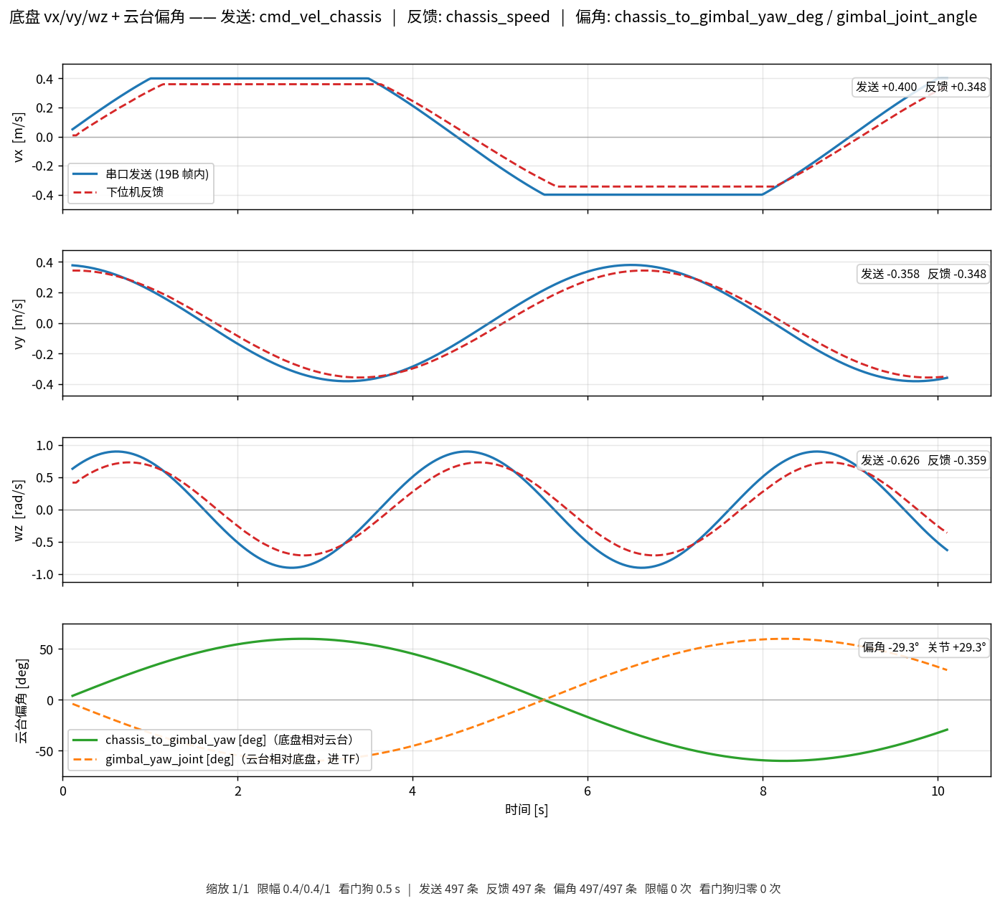
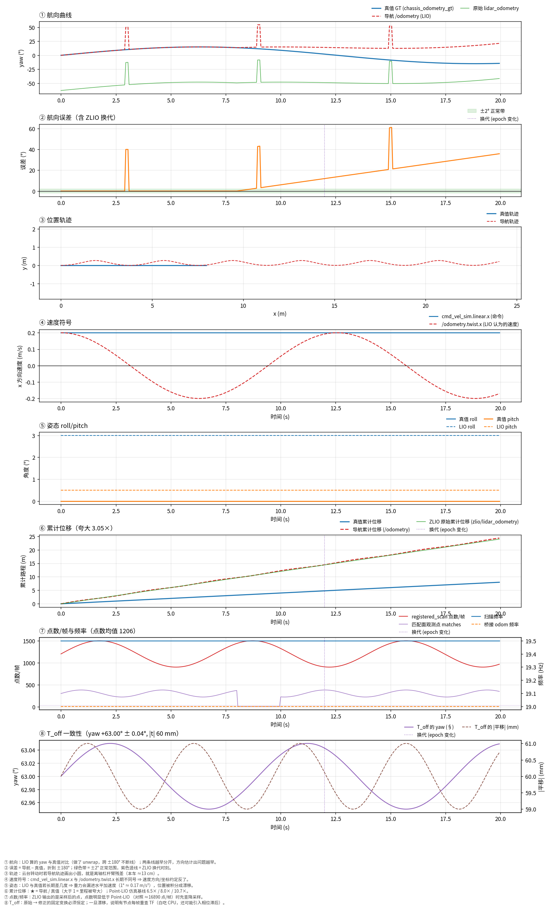
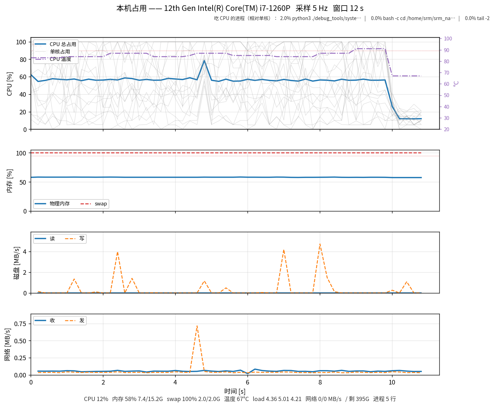
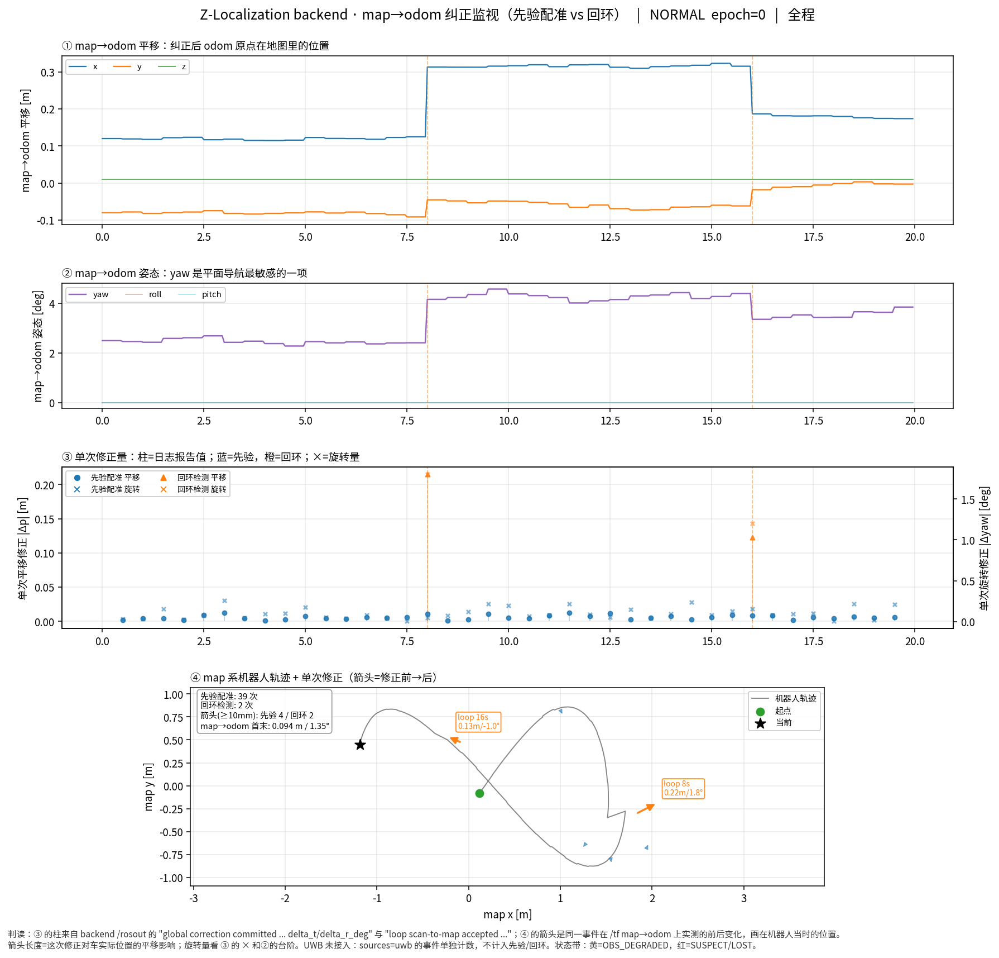
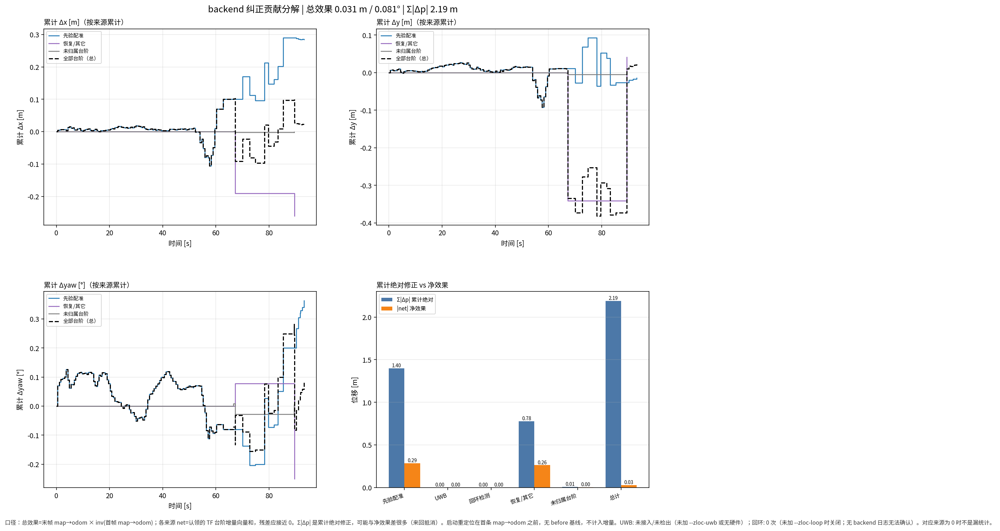
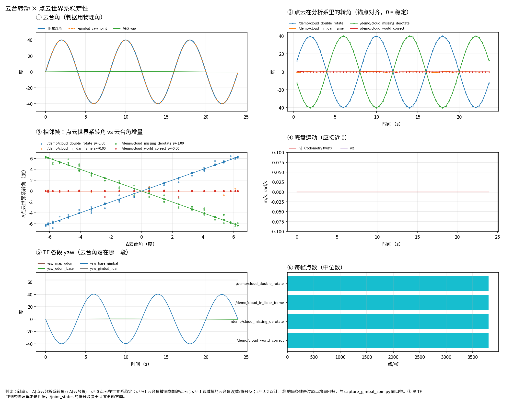
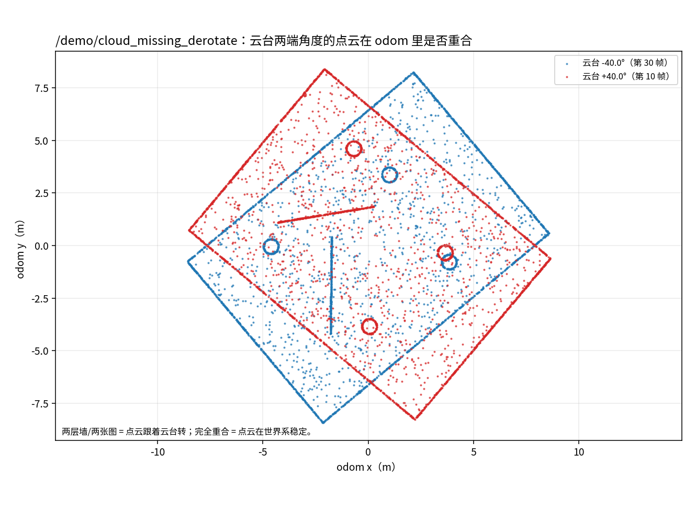

# debug_tools —— 现场排查用的小工具

这里放的是**调试期**用的一次性脚本：不参与 `colcon build`，没有 `package.xml`，
不改导航链路，不往 `/cmd_vel_*` 上写任何东西。每个工具都尽量做成
"读完能自己判断故障在哪一层"，而不是只把数字打出来。

| 工具 | 用途 | 状态 |
| --- | --- | --- |
| `plot_vxvywz.py` | 底盘 vx/vy/wz 波形 + 云台偏角/关节角行（共 8 条曲线） | 可用（对接 `/chassis_speed`、`/chassis_to_gimbal_yaw_deg`、`/gimbal_joint_angle`） |
| `plot_lio_gt_yaw.py` | **LIO 算的车头朝向 vs Gazebo 真值**：yaw 曲线 + 误差 + x-y 轨迹 + 速度符号（共 5 个面板）；加 `--zlio` 再多 3 个面板看里程计前端换成 ZLIO 之后的效果 | 可用 |
| `plot_backend_correction.py` | **backend 的 map→odom 纠正监视**：先验配准 / 回环各自改了多少、改到哪；4 个面板 + CSV | 可用（对接 `/tf`、`/localization/odometry`、`~/localization_state`、`/rosout`） |
| `backend_contribution_report.py` | **先验 / UWB / 回环 / 恢复 / 未归属 / 总计的贡献分解**：累计绝对修正 vs 净效果；读前一个工具的 CSV | 可用 |
| `system_monitor.py` | 本机占用：CPU/内存/swap/温度/磁盘/网络 + **导航栈分组统计** + 最吃 CPU 的进程 | 可用 |
| `capture_gimbal_cloud_rotation.py` | **云台自转时点云到底转不转**：同时录多路点云/TF 链/云台角，用二维配准量出「点云世界系转角 vs 云台角」的斜率（0/±1/±2），输出可交接的数据包 | 可用（实车采集链路已验证；`--demo` 四路已知答案自检通过） |

`plot_vxvywz.py`、`plot_backend_correction.py`、`backend_contribution_report.py` 与 `system_monitor.py` 共用 `_common.py`
（matplotlib 配置目录、中文字体、CSV 落盘、`-h` 输出），改公共行为只改那一处；
`plot_lio_gt_yaw.py` 是后加的，自带一份同样的样板，没依赖 `_common.py`。
`capture_gimbal_cloud_rotation.py` 只从 `_common.py` 取 matplotlib 配置/中文字体，
`-h` 直接打文件头的 docstring；数据落盘、配准和报告都是自带的
（`--analyze`/`--demo` 不 import rclpy）。

---

## 1. `plot_vxvywz.py` —— vx/vy/wz 波形



> 上图是 `--demo` 的合成数据：蓝实线 = 串口发送（19 字节帧内的值），
> 红虚线 = 下位机反馈。演示数据里刻意加了跟随增益和约 0.15 s 的滞后，
> 真实反馈接上之后两条线的差就是这一路的跟随误差。
> 第 4 行是 2026-11-08 新加的云台偏角：绿实线 = 底盘相对云台（度），
> 橙虚线 = 换算进 TF 的关节角（度），默认 `sign=-1` 时两条线镜像。

一张图四行：前三行每行一个速度通道；第四行是云台偏角/关节角。

| 行 | 曲线 | 说明 |
| --- | --- | --- |
| `vx` | 蓝实线 `speed_vector.vx` / 红虚线实测 vx | 19 字节帧里实际发的值 vs 下位机回传 |
| `vy` | 同上，`vy` | 同上 |
| `wz` | 同上，`wz` | 同上 |
| 云台偏角 | 绿实线 `chassis_to_gimbal_yaw`（度）/ 橙虚线 `gimbal_yaw_joint`（度） | 下位机原值 vs 真正接进 URDF/TF 的关节角，见 §1.3 |

### 1.1 蓝线是怎么来的（重要）

工具**不打开串口**（端口被 `srm27_nav_protocol` 独占），而是订阅它的唯一输入
`cmd_vel_chassis`，然后按节点内部 `fillSpeedVector()` 的顺序**复算**出真正写进帧的值：

```text
看门狗（cmd_timeout_sec 内没更新 -> 三个分量一起归零，协议 §6.3）
  -> 乘缩放系数（linear_velocity_scale / angular_velocity_scale）
  -> 按 max_vx / max_vy / max_wz 逐轴限幅（协议 §6.5）
  -> 写进 19 字节帧
```

所以蓝线 = 下位机那一帧实际收到的数字。这四个参数**默认直接读**
`src/srm27_nav_protocol/config/srm27_nav_protocol.yaml`，改 yaml 不用改脚本；
命令行也留了覆盖开关（`--max-vx` / `--linear-scale` / `--cmd-timeout` ...）。

> 这是"按节点逻辑复算"，不是逐字节抓串口。要看原始字节，把 yaml 里
> `debug_print_hex` 打开（注意它会影响定频心跳，见协议 §6.6），
> 或者后续在这里加一个串口嗅探工具。

### 1.2 红线（下位机反馈）从哪来

下位机按 `0x0010` 包回传速度观测值（**2026-11-08 起 5 个 float32**：`vx`/`vy`/`wz`/
`chassis_to_gimbal_yaw_deg` + 云台陀螺仪 yaw 转速；旧固件仍是 4 个），`srm27_nav_protocol`
解出来发**四条**话题（前三条见下表，第四条是 `gimbal_yaw_rate`（`TwistStamped`），
只给 yaw 外推算转速用，本工具暂不画）：

| 话题（默认） | 类型 | 内容 |
| --- | --- | --- |
| `chassis_speed` | `geometry_msgs/msg/TwistStamped` | `twist.linear.x/y` = vx/vy [m/s]（**云台系**，`frame_id=gimbal_yaw`），`twist.angular.z` = wz [rad/s]（**底盘**转速） |
| `chassis_to_gimbal_yaw_deg` | `std_msgs/msg/Float32` | 底盘相对云台的偏角（**度**，(-180,180]，云台指向为 0） |
| `gimbal_joint_angle` | `std_msgs/msg/Float32` | 同上换成 URDF `gimbal_yaw_joint` 的关节角（云台相对底盘，弧度，另带 `gimbal_joint_sign`） |

工具默认订阅 `chassis_speed`（相对名，随 `__ns` 走），`--feedback-type` 三选一：
`twist_stamped`（默认）/ `twist` / `odom`。

两个要点：

1. `0x0010` 里填的是**底盘速度观测器的融合结果**，不是轮速正解，更不是"指令已被执行"
   的回显——指令→底盘→观测本来就有延迟和尺度差，**红蓝两条线之间的差就是这个工具要看的东西**。
2. 反馈超过 `cmd_timeout_sec` 没更新会按"过期"处理（红线断掉），不会平着无限延伸骗人。

红线没有时按这个顺序查：

```bash
ros2 topic hz /chassis_speed          # 应该有 33 Hz 左右（10 ms 槽位轮转）
ros2 topic echo /chassis_speed        # 全 0 = 下位机速度观测器没跑，不是 ROS 侧的问题
grep publish_chassis_speed src/srm27_nav_protocol/config/srm27_nav_protocol.yaml
```

顺带：`srm27_nav_protocol` 会在 `0x0010` 中断 0.5 s 时打 WARN，日志里搜
`底盘速度反馈 (0x0010) 中断` 就知道是链路断还是值不对。

### 1.3 第四行：云台偏角 / 关节角（2026-11-08 新增）

第 4 行的两条线都画成**度**，共用一条轴：

| 曲线 | 话题（默认） | 含义 |
| --- | --- | --- |
| 绿实线 | `chassis_to_gimbal_yaw_deg` | 下位机 `0x0010` 第 4 个 float32 原值：**底盘相对云台**，(-180, 180]，以云台指向为 0 |
| 橙虚线 | `gimbal_joint_angle` | 节点换算后、真正进 `/joint_states` 的 `gimbal_yaw_joint`：**云台相对底盘**，弧度；画图时乘 180/π 换回度 |

怎么读：

- 默认 `gimbal_joint_sign = -1`（两者互为相反数），所以两条线应**关于 0 镜像**：
  手把底盘逆时针转、云台不动 → 绿线往正走、橙线往负走。两条线重合说明 sign 被改成了 +1。
- 两条线在 ±180° 处同时翻一次再回来，是角度跨界的正常折叠（关节角被 wrap 到 (-π, π]），
  不是故障；`sensor_scan_generation` 的 yaw 差动了 `atan2` 归一化，不会因此出速度尖峰。
- 某一侧断流时那条线只断自己：超过 `--angle-timeout`（默认 0.5 s）没更新就留空，
  不画平线冒充"角度没变"（图底会提示在等哪条）。
- 两条线都空：节点版本旧（还没发这两条话题）、或话题名/命名空间不对。先跑
  `ros2 topic hz /chassis_to_gimbal_yaw_deg` 和 `/gimbal_joint_angle`（都应 ≈33 Hz）。

这一行是"云台不动、手转底盘，`base_link` 要跟着转"的**波形版证据**，配合 §1.6 的判读一起看。

### 1.4 用法

```bash
source /opt/ros/humble/setup.bash
source install/setup.bash            # 只用到标准消息时可以省

# 默认：cmd_vel_chassis + chassis_speed
./debug_tools/plot_vxvywz.py

# 带命名空间（两种写法都认）
./debug_tools/plot_vxvywz.py --ros-args -r __ns:=/red_standard_robot1
./debug_tools/plot_vxvywz.py -r __ns:=/red_standard_robot1

# 时间窗 60 s，同时录 CSV
./debug_tools/plot_vxvywz.py --window 60 --csv /tmp/vxvywz.csv

# 跑 30 s 自动退出并存图（不需要人守着关窗口）
./debug_tools/plot_vxvywz.py --duration 30 --save            # -> user_test_log/chassis_vxvywz_20261108_0120.png
./debug_tools/plot_vxvywz.py --duration 30 --save /tmp/vxvywz.png   # 想指定路径就这么写

# 没有显示器 / ssh 上去
./debug_tools/plot_vxvywz.py --headless --duration 20 --save

# 先验证画图链路本身（不连 ROS，用合成数据；文件名带 demo 前缀，不会和实测混在一起）
./debug_tools/plot_vxvywz.py --demo --duration 10 --save
```

`--save` 存的是**整段录制**（从启动到退出，横轴铺满全程），**不是**屏幕上当前显示的
那个 `--window`：屏幕只留最近几十秒方便看形状，存图要能复盘整段。不带路径时统一落到
`<工程根>/user_test_log/`，和 `plot_lio_gt_yaw.py`（`user_test_log/lio_yaw_*.png`）
放一处，事后一起翻；文件名带时间戳，同一分钟重复跑会自动加 `_2`/`_3`，不会覆盖上一次的图。
终端会打印最终绝对路径和 "整段 N s, M 个采样点"。

历史默认全程保留（50 Hz 下 10 分钟约 3 万个采样点，内存无压力）；如果只想跑很久又
只想看最近一段，用 `--history 600` 限制保留时长——注意这时存图也只剩这 600 s。

### 1.5 参数

| 参数 | 默认 | 说明 |
| --- | --- | --- |
| `--send-topic` | `cmd_vel_chassis` | 串口节点的输入话题（相对名，跟随 `__ns`） |
| `--feedback-topic` | `chassis_speed` | 下位机反馈话题（相对名，随 `__ns`） |
| `--feedback-type` | `twist_stamped` | `twist_stamped` = `geometry_msgs/TwistStamped`（0x0010 原生口径）；`twist` = `geometry_msgs/Twist`；`odom` = `nav_msgs/Odometry` |
| `--angle-topic` | `chassis_to_gimbal_yaw_deg` | 第 4 行绿线：底盘相对云台（度） |
| `--joint-topic` | `gimbal_joint_angle` | 第 4 行橙虚线：云台关节角（弧度，进 TF） |
| `--angle-timeout` | `0.5` | 偏角/关节角多久没更新就断开那条线（秒） |
| `--config` | `src/srm27_nav_protocol/config/srm27_nav_protocol.yaml` | 读限幅/缩放/看门狗的来源 |
| `--max-vx` `--max-vy` `--max-wz` | 读 yaml | 覆盖限幅值 |
| `--linear-scale` `--angular-scale` | 读 yaml | 覆盖缩放系数 |
| `--cmd-timeout` | 读 yaml | 覆盖看门狗超时 |
| `--window` | `20` | **屏幕**上的波形时间窗（秒）；不影响 `--save`（存图是整段） |
| `--history` | `0` | 历史保留上限（秒），0 = 全程。存档/退出小结用保留的那段 |
| `--sample-hz` | `50` | 采样记录频率（串口 100 Hz 发，50 Hz 足够看形状） |
| `--plot-hz` | `20` | 界面刷新频率 |
| `--duration` | `0` | 运行时长，0 = 一直跑到关窗口 / Ctrl-C |
| `--csv` | 空 | 录 CSV：`t_elapsed,t_wall,s_vx..,f_vx..,watchdog,clamped,a_chassis_to_gimbal_deg,a_joint_rad`（后两列 2026-11-08 追加在末尾，旧列顺序不变） |
| `--save [路径]` | 空 | 录制结束存 **整段录制** 的 PNG；不带路径 → `user_test_log/chassis_vxvywz_<时间戳>.png` |
| `--demo` | 关 | 合成假数据，不初始化 ROS |
| `--headless` | 自动 | 没有 `DISPLAY` 时自动开启（Agg 后端） |

### 1.6 图上怎么判读

- **蓝线掉到 0、底部"看门狗归零"计数 +1**：上游 0.5 s 没发新指令，串口节点
  在按协议 §6.3 重发零速帧。这是"导航停了/控制器卡了"，不是车的故障。
- **蓝线贴着 `±max_vx` 之类的水平线**：限幅生效，底部"限幅 N 次"会涨。
  注意限幅作用在缩放**之后**。
- **蓝线有、红线没有**：下位机没回 `0x0010`，或者话题/命名空间接错了——按 §1.2 的三条命令依次查。
- **红线在蓝线上一段后突然断掉**：反馈超过 `cmd_timeout_sec` 没更新，
  工具按"过期"处理（避免下位机断链后红色虚线平着无限延伸骗人）。
- **红线和蓝线的差**就是这个通道真实的"跟随误差"——这也是这个工具最主要的用途。
- **第 4 行绿/橙两条线**：看它们是否关于 0 镜像（`sign=-1` 的预期），以及 ±180° 处
  一起翻折后能否接上；某一侧断流只会断那一条。判读细节见 §1.3。

---

---

## 2. `plot_lio_gt_yaw.py` —— LIO 航向 vs 真值

回答一个问题：**"LIO 算出来的车头朝向，和 Gazebo 真值差多少、从什么时候开始差"**。

> **里程计前端换 ZLIO 之后**（2026-11-05 起 `--lio` 默认走 ZLIO），先按 §2.1 加 `--zlio` 跑，
> 三件事一眼可见：位移夸大倍数、`registered_scan` 点数/帧、`T_off` 是否恒定。

图面约定（2026-11-05 调整）：**所有文字都在轴外** —— 标题只留"编号 + 名字"，
图例排在每个面板上方那一行的右侧，长解释统一收到**图底图注**里，曲线区域里不放任何
文字。要一张只有曲线的干净图就加 `--no-caption`（解释改打到终端）。

五个面板（同一时间轴）：

| 面板 | 内容 | 怎么读 |
| --- | --- | --- |
| ① yaw 曲线 | 真值 `chassis_odometry_gt`、导航用的 `/odometry`（`--with-raw` 再加一条 `lidar_odometry`）、以及 **`fake_vel_transform` 的预测 yaw**（`yaw_debug`：odom yaw + ∫wz dt，外推到指令生效时刻）；曲线做了 unwrap | 两条线离得越远，方向越错。粉色那条比导航线更贴真值 → 外推起效（统计里会直接给 `|pred−GT|` vs `|odom−GT|`） |
| ② yaw 误差 | 导航 − 真值，折到 ±180°，带 ±2° 绿带 | 贴着 0 = 换算正确；在"开始动/云台转起来"之后才拉开 = LIO 动态下配准不住 |
| ③ x-y 轨迹 | 真值轨迹 vs 导航轨迹 | 导航画出**小圆**而真值不动 → 云台离轴杠杆臂（本车 ≈13 cm）残差 |
| ④ 速度符号 | `cmd_vel_sim.linear.x` 与 `/odometry.twist.x` | 两条线长期**不同号** → 速度方向/坐标约定反了（"前进变后退"的另一半原因） |
| ⑤ 姿态 roll/pitch | 真值 roll/pitch、导航 roll/pitch（被 planarize 清零，恒≈0）、**ZLIO 原始 roll/pitch**、**bridge roll/pitch** | 后两条是识别「odom 系被转了一个安装角」的关键：正确时两者都 ≈ 雷达安装倾角（仿真 30° roll）。若 bridge 比 raw 多出约 30° → `T_off` 少乘了 `R_0⁻¹`（见实施记录 §5.5）。⚠ 导航那条线被 `planarize()` 清零，**看不出**这种倾斜 |

> ⚠ **用哪个时钟**：`--sim-time auto`（默认）会在检测到 `/clock` 时自动切到**仿真时间**。
> 仿真比实时慢（实测 RTF≈0.77），用墙钟去对仿真时间戳，所有延迟/年龄都会差 1/RTF 倍（约 30%）。
> 显式控制：`--sim-time on` / `--sim-time off`。

用法：

```bash
# 不用仿真，先看工具本身（合成数据里有漂移、跳变和一个 13 cm 小圆）
./debug_tools/plot_lio_gt_yaw.py --demo --headless

# 默认输出到 <工程根>/user_test_log/，文件名带时间戳，不会互相覆盖
#   user_test_log/lio_yaw_20261105_0232.png
#   user_test_log/lio_yaw_20261105_0232.csv

# 真机/仿真录制：与 start_sim_nav.sh 同时跑，结束时出图 + 统计
# 默认一直录：想停的时候按 Ctrl-C，已录部分照样出图（也默认存进 user_test_log/）
./debug_tools/plot_lio_gt_yaw.py --headless
./debug_tools/plot_lio_gt_yaw.py --ros-args -r __ns:=/red_standard_robot1 --with-raw

# 想固定时长也可以（到点自动出图）
./debug_tools/plot_lio_gt_yaw.py --duration 60 --headless --save /tmp/lio_yaw.png

# 只看数字不出图
./debug_tools/plot_lio_gt_yaw.py --duration 30 --stats-only

# 图面只要曲线（不画图底图注，解释改打到终端）
./debug_tools/plot_lio_gt_yaw.py --duration 30 --save /tmp/lio.png --no-caption
```

输出：PNG + 同名 `.csv`（每行一个采样点，默认都在 `user_test_log/`），以及一段统计：平均/最大误差、
单帧跳变次数、**命令与 LIO 速度同号比例**（<70% 基本就是方向反了）。

典型复现流程：终端 A 起 `start_sim_nav.sh ... --lio`，终端 B 跑本工具，终端 C 发目标；
车"往后走"的那几秒正好落在图上，②④ 两个面板能直接把责任落到具体那一段。

### 2.1 `--zlio`：里程计前端换成 ZLIO 之后看什么

`--lio` 现在默认由 ZLIO（z-localization 的 `frontend` 包）产生里程计，坐标系改写与换代锚定由
`zlio_bridge` 负责。上面 5 个面板对"谁产生里程计"是不敏感的，所以加 3 个专属面板：

| 面板 | 内容 | 怎么读 |
| --- | --- | --- |
| ⑥ 累计位移 | 真值 / 导航用 / ZLIO 原始 三条累计路程，标题里直接给出 **★ 位移夸大倍数 = 导航 ÷ 真值**（详细解释在图底图注 ⑥） | Point-LIO 仿真基线是 6.5× / 8.0× / 10.7×；ZLIO 若也在 3~10 倍，第一嫌疑是 `point_time_scale`（把秒当纳秒 → 去畸变失效）。这个倍数**越小越好**，接近 1.0 才叫能用来定位 |
| ⑦ 点数/帧 + 匹配点 + 频率 | `registered_scan` 每帧点数、`zlio_bridge/matches`（匹配面观测点数，紫色）在左轴，频率在右轴；虚线 30 = `min_matches_warn` | ZLIO 输出的是**自适应采样后**的点（1000~4000），Point-LIO 的 `cloud_registered` 约 16,890 点/帧。点数掉太多时 `terrain_analysis` 的地形图会变稀，表现为"避障没坏但明显迟钝"；**matches 掉到几十以下**则是几何退化（正对单面墙/空旷），此时平移方向不可观、位姿开始靠猜 —— "撞墙后飞掉"那一类故障就是从这里开始的 |
| ⑧ T_off 一致性 | `T_off(k) = T_bridge(k) · T_原始(k)⁻¹` 的 yaw 与 \|平移\| | bridge 只查一次 TF，所以这两条线必须**恒定**。yaw 均值应等于 URDF 里 `base_link ← front_mid360` 的安装角（仿真约 63°，另带 30° roll）。⚠ 必须用 **bridge 的 `lidar_odometry`**（修正后的雷达位姿）配原始位姿；用 `/odometry`（车体位姿）配会画出**每转一圈一个锯齿**——两者之间还差一个随云台转动的 `T_base←lidar`。工具默认已用 `--bridge-topic lidar_odometry` |



> 上图是 `--zlio --demo` 的合成数据：⑥ 里位移夸大 3.05×（真值蓝线贴底、导航/原始在上），
> ⑦ 点数稳定在 1200、频率 19~19.5 Hz，⑧ 的 `T_off` 是两条平线（yaw 63°、|t| 60 mm）——
> 这才是正确实现的样子。第 12 s 那条紫色点线是换代，位姿**没有**跳变（锚定生效）。

另外 ②⑥⑦⑧ 上的**紫色点线 = 换代（epoch 变化）**：`zlio_bridge/epoch` 每次换代发一个值。
epoch 变了而位姿**跳一大截** = 锚定没生效，`terrain_analysis` 的地形图会整体错位
（实施方案 §4.3 的必做项）。

```bash
# 先自检工具（不需要仿真）：造一份位移夸大 3×、~1500 点/帧、T_off 恒定、第 12 s 换代的数据
./debug_tools/plot_lio_gt_yaw.py --zlio --demo --headless

# 真实录制（与 start_sim_nav.sh 同时跑；默认文件落在 user_test_log/zlio_scope_<时间>.png）
./debug_tools/plot_lio_gt_yaw.py --zlio --headless
./debug_tools/plot_lio_gt_yaw.py --zlio --duration 60 --headless --save /tmp/zlio_scope.png
./debug_tools/plot_lio_gt_yaw.py --zlio --duration 60 --stats-only     # 只要数字

# 话题名与默认不同时（默认按 <ns>/ 前缀解析，自动识别命名空间）
./debug_tools/plot_lio_gt_yaw.py --zlio --ros-args -r __ns:=/red_standard_robot1 \
    --raw-topic zlio/lidar_odometry --scan-topic registered_scan --epoch-topic zlio_bridge/epoch
```

统计会多打印这几行（`--stats-only` 也有）：

```text
T_off 一致性  : yaw  +63.00° ± 0.035°, |t| 60.0 ± 0.7 mm
点云点数/帧   : 均值 1206, 最小 900, 最大 1500
扫描 Hz         : 均值 19.5 Hz     桥接 odom Hz : 均值 19.0 Hz
累计位移      : GT 7.98 m, 导航 24.35 m, ZLIO 原始 23.94 m
★ 位移夸大倍数: 3.05×
终点位置偏差  : 16.069 m
换代代次      : 0,1（次数 1）
```

> ⚠ 两个已修的坑（改这个工具时别退回去）：
>
> 1. **`DiagnosticStatus.level` 是 `byte`**，ROS 2 的 Python 绑定给它的是**单字节 `bytes`**
>    （`b'\x01'`），不是 int。直接 `int(status.level)` 会崩：
>    `ValueError: invalid literal for int() with base 10: b'\x01'`。
>    工具里统一转成 0/1/2/3。
> 2. **采样率必须真的受限**：录制循环原来每 `spin_once` 回来就存一个点，在 30~200 Hz 消息面前
>    等于 ~500 Hz 采样（实测"5 s 录了 2493 个点"）。现在按 `--rate`（默认 20 Hz）节流，
>    同样的 6 s 只存 ~110 个点，CSV 也不膨胀了。

**原始位姿按 `header.stamp` 与 bridge 输出配对**（两者同戳，实施方案 §4.2），所以 ⑧ 的抖动是
真实抖动，不掺"两帧之间又走了多少"的假噪声。


---

## 3. `system_monitor.py` —— 电脑占用



> 上图是同步跑合成负载（6 个进程烧 CPU + 1 个狂写磁盘，12 s 后停止）时录的：
> 蓝色粗线是整机 CPU，细灰线是 16 个线程各自的占用，紫色点划线是 CPU 温度（右轴）。
> 进程摘要在**图顶部一行**，不再压在曲线上（老版本画在图里，正好会盖住 CPU 冲高那一段）。

**最关心的一条**：图顶部与底部状态行里的 **"导航栈合计 x.xx 核"**——它把
仿真 Gazebo / RViz / Nav2 / 定位里程计 / 雷达驱动 / 底盘串口 六组进程加在一起，
回答"跑这套导航到底占了多少机器"；远程桌面、本工具这类进程单独列，不算进导航的账。

四个子图（`--text` 时是一屏），回答"卡在哪一层"：

| 指标 | 看什么 |
| --- | --- |
| CPU | 总占用（粗线）+ 每个核心（细灰线）+ 温度（右轴） |
| 内存 | 物理内存 + swap 百分比 |
| 磁盘 | 读 / 写 MB/s（累计计数求差得到） |
| 网络 | 收 / 发 MB/s（DDS 狂发时这里会顶起来） |
| 进程表 | CPU% 前 N 个，单行显示在**图顶部**（原来画在图里，会把 CPU 曲线盖住）；`--match` 可以只看 ROS 相关进程 |
| 导航栈分组 | 六组加总 + 各组分解；终端模式另有一张含内存/进程数的分组表 |

### 3.1 用法

```bash
# 实时窗口
./debug_tools/system_monitor.py

# 纯终端（ssh 上去、没有显示器时会自动切到这个模式）
./debug_tools/system_monitor.py --text

# 只打一屏就退出：现场最常用，"现在到底谁在吃 CPU"
./debug_tools/system_monitor.py --text --once

# 只看导航相关进程（命令行/进程名里包含任一关键字即可）
./debug_tools/system_monitor.py --text --match nav2,point_lio,rviz,gazebo

# 跑一分钟，顺便存图和 CSV
./debug_tools/system_monitor.py --duration 60 --window 60 --save /tmp/sys.png --csv /tmp/sys.csv
```

依赖只有 `python3-psutil`（`sudo apt install python3-psutil`），**不需要 ROS**，
所以在别的机器上单跑也可以。

终端模式的分组表长这样（数值是示例）：

```text
 按分组（CPU% 相对单核，100% = 1 核）：
   分组               CPU%      核       内存    进程
   仿真 Gazebo       119.3   1.19    1.7GB     3
   远程桌面            110.2   1.10  476.8MB     1
   Nav2 导航栈         92.1   0.92    2.0GB    14
   RViz              60.4   0.60  858.3MB     1
   定位/里程计          30.2   0.30  572.2MB     4
   雷达驱动             12.0   0.12  190.7MB     1
   底盘串口              3.0   0.03   95.4MB     1
   导航栈合计           317.0   3.17    5.3GB    24   ← 占整机 20%
```

分组规则写在 `system_monitor.py` 的 `PROCESS_GROUPS` 里（按命令行关键字归类，
先匹配先得）。换了节点名/启动方式导致归类不对时，改那张表即可。

### 3.2 参数

| 参数 | 默认 | 说明 |
| --- | --- | --- |
| `--text` | 关 | 纯终端输出；无 `DISPLAY` 且没给 `--save` 时自动开启 |
| `--once` | 关 | 只采一屏就退出（配 `--text`） |
| `--procs` | `6` | 进程表行数，`0` = 不采集进程表（**也就没有导航栈合计**） |
| `--procs-csv` | 空 | 每次进程扫描写一份 CSV（t/分组/pid/cpu/rss/命令），用于事后回溯 |
| `--match` | 空 | 进程过滤关键字，逗号分隔或重复给 |
| `--interval` | `1.0` | 终端模式刷新周期（秒） |
| `--window` | `60` | 波形时间窗（秒） |
| `--sample-hz` | `5` | 采样频率 |
| `--plot-hz` | `1` | 窗口刷新频率（调高会让工具自己吃 CPU；2 Hz 约为 1 Hz 的两倍开销） |
| `--duration` | `0` | 运行时长，0 = 一直跑到关窗口 / Ctrl-C |
| `--csv` | 空 | 录 CSV（每行一个采样点，含 CPU/内存/温度/磁盘/网络/load） |
| `--save` | 空 | 退出时存 PNG |
| `--headless` | 自动 | 没有 `DISPLAY` 时自动开启 |
| `--disk-path` | `/` | 统计哪个挂载点的剩余空间 |
| `--iface` | 空（全部） | 只统计哪些网卡，逗号分隔或重复给；默认含 `lo` |

### 3.3 判读要点

- **"导航栈合计"是六组之和，不含远程桌面和本工具**。所以"整机 CPU 70%"
  与"导航栈 8.2 核（51%）"是两种口径：前者是整机平均，后者是核数，两者之差
  就是远程桌面/工具/系统自身的开销。
- **进程 CPU% 是 psutil 的口径：相对"一个核"**。多线程进程会超过 100%
  （16 线程机器满载可达 1600%），不是整机占比。
- **swap 长期贴满**（本机历史上常年 ~99%）：物理内存不够，整机会变慢，
  这种"卡"和控制器参数没关系，先加内存/关掉不用的进程。
- **温度 ≥ 90°C**：CPU 在降频，同一份代码会突然变慢，波形上表现为
  控制器周期抖动 —— 别去调参，先解决散热/降负载。
- **磁盘写持续很高**：先看是不是自己在录包（`ros2 bag record` 本身就吃满磁盘），
  别把它当成系统问题。
- **网络收发异常高但没在传文件**：先看它是哪张网卡。**默认统计所有网卡（含 `lo`）**，
  而单机跑 ROS 2 + Gazebo 时 DDS 的点云/时钟全走回环，几十 MB/s 很常见 ——
  状态行会标"其中 lo 回环 x/y"，想只看真实网卡就 `--iface wlo1`；
  lo 上真的很高时再考虑调 DDS（共享内存传输、降点云频率）。
- **网络收 ≈ 发 且数值一样大**：基本都是回环（发出去多少就收回来多少），
  不代表网线/无线被打满。
- 工具自身开销：波形模式约占单核 15%（1 Hz 刷新、默认窗口），终端模式约 2%。
  只想快速判断"谁在吃 CPU"用 `--text --once` 最省。

---

## 4. `plot_backend_correction.py` —— backend 的 map→odom 纠正监视



回答一个问题：**backend 到底有没有在修正 `map → odom`？先验配准和回环各改了多少？**

先验配准、运行回环与 UWB 通过 `--zloc-prior`、`--zloc-loop`、`--zloc-uwb`
独立选择，默认关闭，可同时启用。工具按实际提交日志归因：

| 来源 | 触发 | backend 日志 |
| --- | --- | --- |
| 先验配准 | 启用先验，地图匹配通过门控 | `global correction committed: ... sources=prior_scan_to_map ...` |
| 运行回环 | 启用回环，重访且描述子/几何/PCM/创新检验通过 | `loop scan-to-map accepted: ...` |
| UWB | 新鲜观测且时空标定有效，通过门控 | `global correction committed: ... sources=uwb ...` |
| 先验+UWB 联合 | 同周期两项通过联合检验 | `global correction committed: ... sources=prior_scan_to_map+uwb ...` |

联合修正单独标记，不把总修正量重复算作先验、UWB 各自的贡献。
只有收到明确 `loop=disabled` / `effective=false` 配置日志，才显示 `loop=off(config)`；
工具晚启动而错过能力日志时，不根据“有先验但无回环事件”推断回环关闭。

工具把这四类输出拼在一起（**只读，不发控制/服务，不要求打开 backend 的 visualization**）：

| 话题 | 用途 |
| --- | --- |
| `/tf` | `map → odom` 的唯一权威值，画①②④ |
| `/localization/odometry` | map 系机器人位姿；把修正箭头画在“机器人当时的位置”而不是原点 |
| `<ns>/backend_node/localization_state` | 状态、epoch、reason；画状态带和统计 |
| `/rosout` | 解析上面两类 INFO 日志，区分“这次修正属于谁”，并拿日志报告量 |

### 4.1 为什么必须看 `/rosout`

`map → odom` 是一条连续曲线，先验和回环都会改它，**TF 本身不带“谁改的”**。
工具同时给出两列数字：

- **日志报告值**：backend 自己算的 `delta_t` / `delta_r_deg`，是提交那一刻的输出位姿变化；
- **TF 实测值**：在事件附近找 `map → odom` 的前后台阶，换算到机器人位置。

两列接近 → 事件匹配正确、修正真的落到 TF 上。两列差很多 → 事件窗口里混进了别的修正，
或图优化在两次 TF 之间连续改了几次；先看①②的趋势，不要只盯单次数字。

> ⚠ **map→odom 是纠正面，不是定位输出误差。** 前端在自转/激烈运动下漂 0.1 m，
> map→odom 就会反向改 0.1 m；`/localization/odometry`（或 `TF map→base_link`）的
> 输出位姿反而可能是平滑的。判断定位稳不稳请看输出位姿；本工具 ①② 是纠正面视图，
> 不能把它的台阶直接当成定位误差。

> 日志可见性：backend 的领域日志（`global correction committed` / `loop scan-to-map accepted`）
> 原先用独立 logger `backend`，只走 launch 的 stdout，**不会进 `/rosout`**；本次已在
> `apps/main.cpp` 把领域 logger 换成节点 logger，重建 backend 后这些行才会出现在
> `/rosout`。如果你用旧二进制，③ 会一直是空的——先 `colcon build --packages-select
> srm27_zlocalization_backend`，或分别看 launch 的 stdout。

先验和回环可能落在同一帧附近（尤其回环闭合的那次 transaction），所以工具做的是
**全局唯一分配**：每个 TF 台阶最多被一条事件认领；同时按“时间近 + 量级匹配”选，
大台阶优先给回环、小台阶优先给先验。认领不到的记 `TF实测 未捕获`，不会硬凑。

### 4.2 四个面板

| 面板 | 内容 | 怎么读 |
| --- | --- | --- |
| ① `map→odom` 平移 | x/y/z（m）随时间 | 回环闭合处应有台阶；先验是密集的小台阶。长期单向漂移而此处不动 = 先验没进图 |
| ② `map→odom` 姿态 | yaw（粗）、roll/pitch（细），单位° | yaw 台阶对应回环；roll/pitch 应接近 0。若 yaw 台阶没有③的柱对应，查 reset/UWB/恢复 |
| ③ 单次修正量 | 柱=日志报告值；蓝=先验，橙=回环；实心=平移，×=旋转 | 先验柱约 2 Hz、mm~cm 正常；回环柱 dm~m 是闭合。全是 0 而状态 NORMAL → 先验观测被接受但图没变，查 `prior scan-to-map factor accepted` 日志 |
| ④ map 系轨迹 + 箭头 | 机器人轨迹 + 每次修正的前→后箭头 | 箭头方向来回摆、幅度相近 = 先验在追不稳定观测（地图/外参/时间戳）；箭头与①的台阶方向应一致 |

竖直虚线 = 回环时刻；浅色背景带 = 非 NORMAL 状态（黄 `OBS_DEGRADED`，红 `SUSPECT/LOST`）。

④ 有 `--xy-min-span`（默认 2 m）的最小视野：停车时 `/localization/odometry` 的 mm 级
抖动只会缩成一个点，不会被自动缩放放大成“毛线球”；这时看①的 mm 级台阶和③的先验柱，
不要因为④看着没动就以为定位没工作。

### 4.3 用法

```bash
# 先看工具本身（合成数据，不需要 ROS）
./debug_tools/plot_backend_correction.py --demo
./debug_tools/plot_backend_correction.py --demo --headless --duration 25 --save

# backend 已在跑：另开终端
source /opt/ros/humble/setup.bash
source install/setup.bash
./debug_tools/plot_backend_correction.py                     # 一直录，Ctrl-C 出整段图
./debug_tools/plot_backend_correction.py --duration 120      # 固定 2 分钟
./debug_tools/plot_backend_correction.py --ros-args -r __ns:=/red_standard_robot1
./debug_tools/plot_backend_correction.py --duration 60 --stats-only   # 只看数字
./debug_tools/plot_backend_correction.py --headless --save /tmp/bc.png # ssh/无显示器

# backend 日志被压掉时，至少还能看 TF 曲线（③ 会空着）
./debug_tools/plot_backend_correction.py --rosout-topic ""
```

实车/仿真建议流程：先启动 backend，等 `localization_state` 到 `NORMAL`，再开本工具；
然后按验收动作走（直行、转向、回到旧地点）。验证回环须显式添加 `--zloc-loop`；
可保留 `--zloc-prior` 和 `--zloc-uwb`，并检查启动日志三项能力是否符合预期。
**工具启动时 backend 可能已经跑了一会儿**，所以“首末变化”是录制窗口内的变化，
不是从 backend 启动那一刻算起。

### 4.4 参数

| 参数 | 默认 | 说明 |
| --- | --- | --- |
| `--duration` | `0` | 录制时长（秒）；0 = 一直录到 Ctrl-C |
| `--plot-hz` | `5` | 实时窗口刷新频率 |
| `--window` | `120` | **实时窗口**只显示最近多少秒；最终 PNG 始终是全程 |
| `--tf-topic` | `/tf` | TF 话题 |
| `--odom-topic` | `/localization/odometry` | backend 的 map 系里程计 |
| `--odom-hz` | `20` | 里程计降采样频率；0 = 全存 |
| `--state-topic` | `backend_node/localization_state` | 相对名会按 `--namespace` / `__ns` 展开；空串关闭 |
| `--rosout-topic` | `/rosout` | 修正日志来源；空串则只看 TF |
| `--node-match` | `backend` | 只接受名字含该子串的 `/rosout` 日志；backend 的日志器名是 `backend`（不是 `backend_node`），默认值同时匹配两者 |
| `--namespace` | 空 | 命名空间；也可用 `--ros-args -r __ns:=...` |
| `--map-frame` / `--odom-frame` | `map` / `odom` | TF 名不是这两个时改 |
| `--match-before` / `--match-after` | `0.25` / `0.35` | 事件匹配 TF 台阶的前/后窗口（秒） |
| `--arrow-min` | `0.01` | ④ 里先验箭头的最小长度（米）；回环始终画 |
| `--xy-min-span` | `2.0` | ④ 的最小视野边长（米）；停车抖动不会被放大成毛线球 |
| `--unassigned-translation` / `--unassigned-yaw` | `0.02` / `0.5` | 统计“未归属跳变”的阈值 |
| `--print-delta` | `0.02` | 终端实时打印先验事件的最小平移（米）；回环始终打印 |
| `--verbose` | 关 | 实时打印每一条先验事件 |
| `--demo` / `--headless` / `--stats-only` / `--save` / `--csv` | — | 同其他工具 |
| `--no-caption` | 关 | 不把解释画进图里，解释改打到终端 |

输出（**默认全部落在本项目的 `user_log/`**）：

- PNG：`<工程根>/user_log/backend_correction_<时间戳>.png`（`--save` 可覆盖）
- `<同名>_samples.csv`：`map→odom` / 里程计 / 状态逐行
- `<同名>_events.csv`：每次事件一行，含日志报告值与 TF 实测值（`tf_dxy_m` / `tf_dyaw_deg`）
- 终端：每 5 s 一行摘要；结束按来源分组统计，并报告“未归属跳变”

路径规则：

- 不写 `--save`：`user_log/backend_correction_<时间戳>.png`；
- 只给文件名（`--save pic.png`）：落到 `user_log/pic.png`；
- 给绝对路径/带目录的相对路径：尊重用户；**目录不可写时自动回退到 `user_log/` 并打警告**，
  不再抛 `PermissionError`。例如误写成 `--save /user_log/pic.png`（根目录）会回退到
  `<工程根>/user_log/pic.png`，CSV 也跟着落到那里。

### 4.5 判读与常见故障

- **③ 一直是空的，但 ① 有台阶**：`/rosout` 没收到 backend 日志。查
  `ros2 topic echo /rosout | grep -E 'global correction|loop scan'`；再查
  `--log-level` 是否把 INFO 压掉、`--node-match` 是否匹配节点名。
- **③ 里先验很密但 ① 几乎不动**：修正量确实只有 mm 级，或先验只更新了协方差/描述子位置
  而没有改全局位姿。看 backend 日志 `prior scan-to-map factor accepted` 是否持续出现；
  停着不动时 mm 级是正常的。
- **④ 箭头方向来回摆**：先验观测不稳定。优先查先验地图与当前场地是否一致（错误地图会
  被创新检验拒绝或进入 OBS_DEGRADED）、雷达外参与 `common.sensor_frame`、时间戳/同步。
- **回环始终为 0**：检查启动日志中的 `loop=enabled/disabled` 与 `--zloc-loop`。
  若已开启，检查轨迹是否真正重访、`exclude_recent`、`candidate_max_distance`、
  描述子/几何/PCM/创新检验；先验开启本身不会关闭回环。
- **“未归属跳变” > 0**：TF 上出现了没有日志对应的大台阶。常见于 reset（`map→odom`
  会按坐标边界换一次）、LOST 冻结后恢复、或 `/rosout` 漏收。结合 `localization_state`
  的 epoch 和 reason 一起看。
- **UWB**：默认关闭，`--zloc-uwb` 显式开启。单独与联合提交分别计数，0 次单独事件
  不代表 UWB 没有参与联合融合；还需检查实际话题、时空标定与门控日志。
- **3D vs 2D**：backend 的 `map→odom` 是 4×4，工具原样画 roll/pitch；Nav2 侧会投影，
  所以①②里看到小角度 roll/pitch 不代表导航链有问题，但持续增大要查外参。

### 4.6 贡献分解：先验 / UWB / 回环 / 恢复 / 总效果

主工具回答“哪次修正、什么来源”；这个报告回答**每个来源一共贡献了多少，以及总效果是多少**。
它不连 ROS，直接读主工具落盘的 `<name>_samples.csv` / `<name>_events.csv`：

```bash
# 默认找 user_log/ 下最新的 *_samples.csv
./debug_tools/backend_contribution_report.py

# 指定某次录制
./debug_tools/backend_contribution_report.py \
  --samples user_log/pic_samples.csv \
  --events  user_log/pic_events.csv

# 只打印表，不出图
./debug_tools/backend_contribution_report.py --stats-only
```

**分别看三个部分**：三项开关已经独立，建议按单开关各跑一次，每次用不同 `--save` 名，报告自然只在该来源行有数据：

```bash
# 1) 先验 only
./scripts/bringup/start_real_nav.sh --lio --lio-frontend zlio \
  --zloc-backend --zloc-prior --zloc-map /abs/map_bundle

# 2) 回环 only（无先验图；运行轨迹重访时才有 loop 事件）
./scripts/bringup/start_real_nav.sh --lio --lio-frontend zlio \
  --zloc-backend --zloc-loop

# 3) UWB only（需要真实 UWB + 现场标定 YAML；没有硬件时报告会是 0/未接入）
./scripts/bringup/start_real_nav.sh --lio --lio-frontend zlio \
  --zloc-backend --zloc-uwb --zloc-config /abs/uwb.yaml

# 4) 三个全开（总效果）
./scripts/bringup/start_real_nav.sh --lio --lio-frontend zlio \
  --zloc-backend --zloc-prior --zloc-loop --zloc-uwb \
  --zloc-map /abs/map_bundle --zloc-config /abs/uwb.yaml

# 每次跑完后（默认找最新 CSV；也可显式给 --samples/--events）
./debug_tools/backend_contribution_report.py --stats-only
```

- 单开关运行的 `net` 就是该来源的净贡献；`Σ|Δp|` 是活动量。
- 三个全开时，如果一次 `global correction committed` 同时含 `sources=prior_scan_to_map+uwb`，
  日志只有一个联合 `delta_t`，报告归到 `prior_uwb`（联合），**无法从日志拆成两项**；
  要拆开就在同一份数据上分别看单开关运行，或给 backend 增加逐因子贡献输出。
- UWB 与回环当前都默认关闭；UWB 没接硬件时不要用 `--zloc-uwb` 判断算法效果。



本次数据（93 s，含自转）的输出：

| 来源 | 台阶数 | Σ\|Δp\| | net Δx | net Δy | net Δyaw | max |
| --- | ---: | ---: | ---: | ---: | ---: | ---: |
| 先验配准 | 113 | 1.400 m | +0.285 m | -0.015 m | +0.364° | 0.174 m |
| UWB | 0 | — | — | — | — | 未接入 |
| 回环检测 | 0 | — | — | — | — | 未加 `--zloc-loop` / 未闭合 |
| 恢复/其它 | 2 | 0.779 m | -0.261 m | +0.041 m | -0.250° | 0.390 m |
| 未归属台阶 | 6 | 0.010 m | -0.002 m | -0.004 m | -0.033° | 0.004 m |
| **总计（map→odom 首末）** | 121 | **2.189 m** | **+0.022 m** | **+0.022 m** | **+0.081°** | — |

表里要同时看两列：

- **Σ|Δp|**：累计绝对修正量（所有台阶长度相加），反映“修正活动量”；
- **net Δx/Δy/Δyaw**：各来源认领的 map→odom 台阶增量向量和，反映“净贡献”。

上表的重点：**净效果只有 +2.2 cm / +2.2 cm / 0.08°，但累计绝对修正 2.19 m**。先验的 +0.285 m 与恢复的 -0.261 m 在 x 方向几乎抵消；所以“首末变化很小”绝不等于“没有修正”。报告末尾会打印残差（总效果 − 各来源向量和，正常应接近 0）。

口径与边界：

- baseline 是第一条 `map→odom`；**启动重定位在首条 TF 之前，没有 before 基线，不计入增量**，表下会单独列出（本次 `0.637 m / 38.58°`）。
- UWB 未接入时显示 0 是预期；回环由 `--zloc-loop` 独立控制（可与先验/UWB 同开），未加开关时 0 也是预期。要测回环请加 `--zloc-loop`，并让轨迹实际重访；有 backend 日志时加 `--backend-log` 可确认是 disabled 还是 enabled 但未闭合。
- 如果 UWB 行显示 **“启用，0 次（未收到有效 UWB 观测）”**，说明 `--zloc-uwb` 开了但 `/uwb_pose` 没进来（或全部被拒），不能据此评价 UWB 算法效果；先查 UWB 话题、frame、天线杆臂和时间偏置。
- 如果 backend 同时接受先验+UWB，日志只有一条联合 `delta_t`，报告会归到 `prior_uwb`（联合），**无法从日志拆成两项**；要拆需要 backend 额外输出每类因子的贡献。
- 输出：`<stem>_contributions.png`、`<stem>_contributions.csv`（默认与 samples 同目录）。

### 4.7 限制

- 依赖 backend 的 INFO 日志文案。只认三种固定提交日志（`loop scan-to-map accepted:`、
  `global correction committed:`、带 `delta_t` 的 `localization state ->`），**不做模糊匹配**：
  `prior scan-to-map factor conflicted` / `physical correction cap` 虽然也带 `delta_t`，
  但那是被拒绝的观测，图没有变化。文案改了，解析会退化成“没有事件”，先跑
  `--stats-only` 看 ③ 是否有数。
- 事件时间用**消息到达墙钟**对齐，仿真时间/实时都能用；如果系统负载很高导致
  `/rosout` 比 TF 晚 >0.35 s，可把 `--match-after` 调大。
- `map→odom` 是动态 TF，工具启动前的那段历史补不回来；要看完整初始化过程就尽早启动。
- 长时间运行（>1 h）时 `--window` 只限制**显示**，内存里仍保留全程；需要更长时间建议分段录。

---

## 5. 2026-11-04 的配套改动

为了"图上看到的就是下位机收到的"，`src/srm27_nav_protocol/config/srm27_nav_protocol.yaml`
里的速度对齐系数被去掉：

```diff
-    linear_velocity_scale: 0.80
-    angular_velocity_scale: 0.8
+    linear_velocity_scale: 1.0
+    angular_velocity_scale: 1.0
```

⚠ **风险**：0.80 原本是为了抵消实测"实际速度 / 指令值 ≈ 1.263"的标定值，
去掉之后车实际会跑到指令的约 **1.26 倍**。原标定依据（2026-10-09 实车录包）
写在 yaml 注释里，改回 `0.80` / `0.8` 即可恢复，不用改代码。
第一次实车前建议把车架起来看波形，或者先把 `max_vx` / `max_vy` 调小再跑。

---

## 6. 常见问题

| 现象 | 排查 |
| --- | --- |
| 图上一条线都没有 | `ros2 topic hz cmd_vel_chassis`；命名空间是否要 `__ns`；工具启动后会打印"[就绪] 已收到 ..."或 5 s 后的提示 |
| 有 `/cmd_vel` 但没有 `/cmd_vel_chassis` | 串口节点订阅的是 `cmd_vel_chassis`，`fake_vel_transform` 那一级才是改名点（见 README 速度链路图） |
| 时间轴不动 / 从 0 开始一直不变 | 开了 `use_sim_time` 但没有 `/clock`，工具会自动退回墙钟并提示 |
| 中文显示成方块 | 缺 CJK 字体；脚本会自动挑 Noto/Droid Sans Fallback，装一个 CJK 字体即可 |
| 弹不出窗口 | 没有 `DISPLAY`：用 `--headless --save xx.png` |
| Ctrl-C 后 CSV 不完整 | CSV 每秒落盘一次；`kill -9` 仍会丢最后 1 秒，正常 Ctrl-C 不会 |
| 系统占用里进程表只有几个进程 | 容器/受限环境（hidepid、PID 命名空间）下 `psutil` 只能看到本命名空间的进程；整机 CPU 仍是对的 |
| 系统占用里磁盘/网络显示 "—" | 速率是"两次采样求差"，第一个采样点没有基准；`--once` 会自动等第二个点，正常不会出现 |

---

## 7. `capture_gimbal_cloud_rotation.py` —— 云台转，点云跟着转吗



回答一个问题：**底盘停着、只转云台时，点云在 odom 里到底转不转、转多少。**
这是「我车的定位挺准，但整片点云跟着云台来回摆」这类现象的分层工具：它不猜，
直接量出「点云世界系转角」对「云台角」的斜率，再把这个数字翻译成故障层。

### 7.1 为什么不能只盯着 RViz

同一个「点云在转」的观感，至少有两种完全不同的原因：

| 层 | 原因 | 点云内容真转了吗 | 该改哪 |
| --- | --- | --- | --- |
| A. 上游/坐标 | 点云其实在车体系却标成 odom；去旋转漏了/符号反了/补了两次；前端输出点云的参考时刻和位姿不一致 | **是** | `zlio_bridge` 的 `cloud_pose`、前端 `FrontendFrame.cloud` 的帧契约、`sensor_scan_generation` 的 odom 表达 |
| B. 显示/TF | RViz Fixed Frame 不是 map；同一 child 有两个 parent；某个静态外参随云台动；看的是另一路点云 | **否** | TF 树、RViz 配置、静态外参 |

RViz 只能告诉你「看起来在转」。本工具把**云台角**和**每路点云的世界系转角**同时录下来，
用相邻帧二维配准直接量后者，再回归到前者：

| 斜率 s | 含义 | 点云 frame 是 odom/世界系 | 点云 frame 是车体系/云台系 |
| --- | --- | --- | --- |
| ≈ 0 | 点云在世界系稳定 | 点云没问题，去查显示层 | TF 在正常补偿云台角 |
| ≈ +1 | 云台角被同向加了一次 | 变换里**多**了一份云台角 | 不该再被 TF 转一次 |
| ≈ -1 | 该减的云台角没减/符号反了 | 去旋转漏了、`gimbal_joint_sign` 反了、点云是车体系却标成 odom | 查 TF 符号与 joint 轴向 |
| ≈ ±2 | 同一个角算了两次 | 既在点云里去旋转、又在 TF 里补了一次 | 双计 |
| 相关性 <0.5 | 斜率不可信 | 先看内点率、场景几何、云台行程 | 同左 |

回归用**过原点的增量回归**（`s = Σ(Δψ·Δθ)/Σ(Δθ²)`），和 `capture_gimbal_spin.py`
的判据同口径，所以「转过去再转回来」也能判；逐帧增量只看相邻两帧，不靠首末两点。
另外再做一路「每帧直接对齐锚点帧」的漂移无关校验，两路斜率应一致。

### 7.2 它录什么

| 类别 | 内容 |
| --- | --- |
| 点云 | 自动识别最多 6 路：`registered_scan` / `sensor_scan` / `terrain_map` / `terrain_map_ext` / `cloud_registered` / Livox 原始点云；按 `--rate`（默认 5 Hz）限频、体素降采样到 `--max-points` |
| 云台角 | `/joint_states` 的 `gimbal_yaw_joint`、`/chassis_to_gimbal_yaw_deg`、以及 **TF 口径** `yaw(odom->gimbal_yaw) − yaw(odom->base_link)`（判据用最后这路） |
| 位姿 | `/odometry`（导航用，child=`gimbal_yaw`）、`/lidar_odometry`（雷达位姿） |
| TF | `map->odom`、`odom->base_link`、`base_link->gimbal_yaw`、`gimbal_yaw->livox_*`，按每帧 `header.stamp` 查，不用最新值硬套 |
| 健康检查 | 同一 child 多 parent、`odom->lidar` 与 `/lidar_odometry` 是否同源、底盘是否真的静止、TF 查询失败计数、相关节点参数（只读） |

产物是一个**自解释数据包**（默认 `user_test_log/gimbal_cloud_<时间戳>/`，不进 Git）：

```text
manifest.json              环境/话题/帧/git/参数/TF 快照
samples.csv                20 Hz 标量（云台角三路、TF 各段 yaw、底盘位姿/速度）
raw/<话题>.npz             每帧点云（发布帧坐标）+ 逐帧 TF 矩阵 + 逐帧云台角
clouds/*.pcd               关键帧（已变换到分析系，CloudCompare 可直接开）
clouds/index.csv           每个 PCD 是第几帧、云台多少度
analysis/pairs.csv         每对相邻帧的 Δψ/Δθ、内点率、平移、锚点结果
analysis/analysis.json     关键数字的机器可读版本
analysis/plots.png         六面板总图
analysis/cloud_overlay.png 云台两端角度的点云叠加
report.md                  结论 + 证据 + 按斜率给出的排查方向
bag/                       --bag 时的 rosbag（默认不录，点云很占空间）
```

### 7.3 用法

```bash
# 先起导航，等话题稳定；再开本工具（只读，不发任何控制/TF）
source /opt/ros/humble/setup.bash
./debug_tools/capture_gimbal_cloud_rotation.py --duration 90 \
  --note "场地 A，手转云台 ±40°，约 20°/s，两个来回"
# 终端提示「就绪」后按下面的动作走：
#   0~10 s  不动（基线）
#   → 慢慢转到 +30~45°，停 2 s
#   → 转回中间，再到 -30~45°，停 2 s
#   → 回中间停 2 s；整套重复 2~3 次（约 60~90 s）
# 到点自动结束；Ctrl-C 只按一次，后面收尾/分析不要再按

# 一直录到 Ctrl-C（推荐，动作看得到再停）
./debug_tools/capture_gimbal_cloud_rotation.py

# 只录不分析，回头再算（数据包可以整个拷给别人）
./debug_tools/capture_gimbal_cloud_rotation.py --duration 60 --no-analyze

# 对已有数据包重算（不需要 ROS，只要 numpy/scipy/matplotlib）
./debug_tools/capture_gimbal_cloud_rotation.py \
  --analyze user_test_log/gimbal_cloud_20261124_001234

# 自检：不连 ROS，造 4 路已知答案的点云（正确 / 车体系 / 漏补 / 双计）
./debug_tools/capture_gimbal_cloud_rotation.py --demo

# 有命名空间 / 要顺带录 bag
./debug_tools/capture_gimbal_cloud_rotation.py --duration 60 \
  --ros-args -r __ns:=/red_standard_robot1 --bag
```

关键参数：

| 参数 | 默认 | 说明 |
| --- | --- | --- |
| `--duration` | `0` | 录多久；0 = 一直录到 Ctrl-C。**就绪之后才开始计时** |
| `--wait` | `60` | 等点云/TF 就绪的上限（秒） |
| `--rate` | `5` | 点云存储频率（话题 10 Hz 时存 5 Hz 足够） |
| `--max-points` | `4000` | 每帧最多存多少点（体素 `--voxel 0.10` 之后） |
| `--cloud-topics` | 自动 | 显式指定，逗号分隔或重复给；自动识别按候选表优先级 |
| `--analysis-frame` | `odom` | 分析系；想看 map 系就传 `map`（用每帧的 `map->odom`） |
| `--align-points` | `900` | 每帧参与配准的点数 |
| `--yaw-range` | `60` | 配准搜索的 ±范围（度）；转得猛/行程大时放宽到 90 |
| `--inlier-dist` | `0.15` | 配准内点距离（米）；稀疏场景可放宽到 0.2 |
| `--min-travel` | `10` | 云台行程低于这个值直接判「数据不足」 |
| `--min-dtheta` | `0.15` | 相邻帧云台角增量小于这个值就不进回归（度）；转得特别慢时调小 |
| `--orbit-min` | `0.03` | 平移绕圈半径超过这个值（米）就单独判读；默认 3 cm |
| `--pcd-max` | `40` | 每路最多落多少个关键帧 PCD |
| `--bag` | 关 | 顺带录 rosbag；点云全量，注意磁盘 |
| `--tar` | 关 | 分析完把整个数据包打成 `.tar.gz`，方便发人 |
| `--note` | 空 | 动作备注（方向/幅度/速度/场地），写进 `report.md` 和 `manifest.json` |

### 7.4 图上/报告里怎么读

- **① 云台角**：蓝线是 TF 口径的物理角，橙虚线是 `-gimbal_yaw_joint`。本车 URDF 的关节轴
  是 `-z`，所以关节值 +28° 对应物理角 -28°；两条线应重合。判据永远用蓝线，不看符号。
- **② 点云世界系转角**：横轴时间、纵轴度。平稳 → 点云在世界系里没转；跟着云台走 → 斜率大。
- **③ Δψ vs Δθ**：每一对相邻帧一个点。斜率就是判据；点云越散，内点率/场景几何越差。
- **④ 底盘运动**：应该贴 0。若这里有量，斜率会被底盘运动污染，报告会标出来。
- **⑤ TF 各段 yaw**：云台角落在 `yaw_base_gimbal` 这一段；`yaw_gimbal_lidar` 是固定安装角；
  `map->odom` 是 backend 的纠正面。
- **⑥ 每帧点数**：掉到几十说明几何退化，配准不可信。
- **平移绕圈**：报告表格里这一列是锚点平移对云台角拟合出的圆半径。yaw≈0 但 R>3 cm 时
  会判 `translation_orbit`——点云不是转，而是整体绕车体平移（障碍物会跟着绕）。

`report.md` 会把「斜率 → 优先查哪里」直接列成表，并给出本次的云台行程、底盘位移、
TF 同源性、多 parent 检查结果。



> demo 里「漏补 -θ」那一路在云台 -40° 和 +40° 的点云被转开了 80°，两条墙/两张图；
> 正确的那路完全重合。这就是「点云跟着云台转」最直观的证据。

### 7.5 实测与自检

- **实车静态 20 s**（云台没转，`/registered_scan` 等 5 路各 ~110 帧）：TF 全命中，
  相邻帧中位内点率 **0.91~0.97**，判「行程不足」——符合预期。
- **真实点云注入已知转角**：对实车 `/registered_scan` 的每帧绕雷达反向转 `-θ`
  （θ=30°·sin(2πt/8)），测得斜率 **-0.941**、锚点斜率 **-1.009**、r=-0.91，
  判 `follow_neg`；原样不动的那路斜率 -0.089、判 `stable`。
- **`--demo` 四路自检**：正确 / 车体系 / 漏补 / 双计 四路斜率分别 0.00 / 0.00 / -1.00 / +1.00，
  `PASS` 全过。自检也验证了「点云在车体系里、但 TF 正确」时世界系是稳定的——所以
  **frame_id 不同不等于有 bug**，判据是变换后的世界系。
- **2026-11-24 实车：yaw 稳定但平移绕圈**。`--lio` 3 个来回、104.5° 行程：5 路 yaw 斜率
  -0.02~+0.04，但锚点平移对云台角拟合出 **R≈9.6 cm** 的圆（`registered_scan`；
  `sensor_scan` 9.2、`terrain_map_ext` 7.6），同段 `odom→base` 只 R≈1.8 cm；backend 包
  同样 9.8/1.8。工具现在把这种情形判 `translation_orbit`（报告有「平移绕圈」列），
  不再只看 yaw。根因与改动见 `docs/records/2026-11-24-云台点云平移绕圈(ai).md`：
  `pose_body_offset` 被同时施加到世界点云上，已改成 `apply_to_cloud: false`。

```bash
cd debug_tools && python3 -m unittest test_capture_gimbal_cloud_rotation -v
```

### 7.6 交接给别人时发什么

只发**整个数据包目录**（或 `--tar` 的 `.tar.gz`）即可，里面有 `report.md`、
`manifest.json`、原始点云 `raw/*.npz`、关键帧 `clouds/*.pcd`、逐对结果 `analysis/pairs.csv`。
对方不需要 ROS，装 `numpy/scipy/matplotlib` 就能：
`--analyze <包> --yaw-range 90` 重算，或在 CloudCompare 里直接看 `clouds/*.pcd`。
`manifest.json` 里的 `parameters` 是采集时 `ros2 param dump` 的原样输出，
排查 `pose_body_offset_*`、`lidar_frame`、`ground_frame` 这类参数时不用再问现场。

### 7.7 限制

- 配准是**二维**的（yaw + xy），roll/pitch 不进斜率；本问题正好是二维。
- 正对单面墙/空旷场地时几何退化，内点率低，斜率要打折；报告会标。
- 逐帧增量回归把每对相邻帧当独立样本，同时给锚点斜率做交叉验证，两者应一致。
- 工具启动前/就绪前的历史补不回来；要覆盖完整动作请先开工具再转云台。
- 点云按 `header.stamp` 查 TF；超过 `--tf-cache`（默认按 `--duration+30 s`，最少 90 s）的帧会跳过。
- 一个数据包约 70 MB/分钟（5 路 × 5 Hz × 4000 点）；长时间录请用 `--no-pcd` 或减 `--max-topics`。

---

## 8. `diag_map_odom_spin.py` —— `map→odom` 转圈到底是谁干的

现场"点云地图跟着云台转"有两种完全不同的成因，处置相反：

| 成因 | 特征 | 处置 |
| --- | --- | --- |
| **冻结态反算**（设计行为） | `map→body` 不动，`odom→body` 跟着云台转，`map→odom` 以 **-云台角速度**匀速转；状态串 `pose_trusted=false` / `tf_frozen=true` | 修"为什么进冻结"（观测模型/先验图），不要动 TF 数学 |
| **校正被吃进地图系** | `map→body` 也大幅摆（车真被转走了） | 查累计闸、恢复提交、图优化 |

`pose_output.cpp::TrustedPoseProjector::project` 在不可信时是
`T_map_odom = T_map_sensor_frozen · T_odom_sensor⁻¹`，"云台就是车"时 odom 的 yaw
跟着云台转，于是 `map→odom` 必然以 -云台角速度转。

判据是**三列对照**：甲 `yaw(map→odom)`、乙 `yaw(odom→body)`、丙 `yaw(map→body)`。

```bash
./debug_tools/diag_map_odom_spin.py                 # 跑 30 s：开起来，转云台/往前开
./debug_tools/diag_map_odom_spin.py --duration 60
./debug_tools/diag_map_odom_spin.py --body-frame body   # 车体系不叫 gimbal_yaw 时
```

输出示例（2026-11-27 实车嫌疑场景的合成复现）：

```
  甲 yaw(map→odom) 跨度  1785.0°   （平均 150.0°/s）
  乙 yaw(odom→body) 跨度 1785.0°
  丙 yaw(map→body)  跨度     0.0°   ← 真正的定位结果
  甲 对 乙 的回归斜率 : -1.00   （冻结反算应 ≈ -1）
  tf_frozen=true 占比 : 100%    pose_trusted=false 占比: 100%
  reason 命中统计     : 累计锚点拦下×37
[结论] 冻结态反算（设计行为，不是校正被吃进地图系）
```

`reason 命中统计` 顺带回答"累计修正闸到底有没有开火"（`cumulative correction anchor`）、
"是不是恢复在提交"（`recovered via`）、"是不是观测模型失效"（`observation model invalid`）。

离线吃包（不开 ROS，直接给已录的包；分析完的包不用再跑一遍现场）：

```bash
./debug_tools/diag_map_odom_spin.py --bag ~/srm_nav_27_data/bags/real_zloc_1127_012727
```

退出码：0 = 稳定；1 = 校正被吃进地图系；2 = 冻结态反算；3 = 数据不足；
4 = `map→odom` 锁存（`--zloc-prior-once` 模式，这份包不能用来复现"地图跟着雷达转"）。

---

## 9. `plot_bag_trajectory.py` —— 从包还原轨迹并叠到先验点云

"定位飘了"只看 TF 数字看不出所以然，得把轨迹画在地图上。工具同时给 odom 系与 map 系
两条轨迹，形状一致但整体错位/错角 → 错的是 `map→odom`；形状本身变形 → 错的是前端。

```bash
./debug_tools/plot_bag_trajectory.py --bag ~/srm_nav_27_data/bags/real_zloc_1127_012727
./debug_tools/plot_bag_trajectory.py --bag ... --map-pcd maps/pcd/map_bundles/227to219_1125/map.pcd
./debug_tools/plot_bag_trajectory.py --bag ... --no-map          # 只画轨迹
```

输出到 `user_test_log/traj_<包名>_<时间>.png` 与同名 `.csv`（逐点 map/odom 位姿）。
四个面板：A map 系轨迹叠先验图（自动缩放到轨迹）、B odom 系轨迹、C 角速度、D 速度。

两个坑（第一版都踩过，留作记录）：

1. **列序**：轨迹行统一存 `(t, x, y, yaw)`。yaw 和 x 换位会让 300 m 算成 30 km。
2. **采样间隔不均**：TF 到达间隔在 0.1~0.4 s 之间跳，直接 `Δyaw/Δt` 会把
   "0.4 s 转 60°" 算成 **3400°/s** 的假尖峰。工具内部统一重采样到 10 Hz 再算速率。
   2026-11-27 那份包的正确结论是：峰值 **265°/s**、中位 143°/s、总转角 16209°（45 圈）。

map→odom 还没有的时间段（初始化之前）会被丢掉，不会拿单位阵硬凑成 map 系轨迹。
