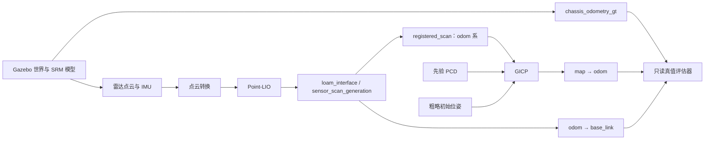

# GICP 初始重定位仿真验证方案

本文针对本工程 `small_gicp_relocalization` 与 SRM Gazebo 仿真链路，给出可执行的验证流程。参数与实现依据为 2026-10-11 的工作区源码。位置初值误差 ≤1 m、航向初值误差 ≤90°、初始化 ≤10 s 和不接受错误匹配为用户明确的要求；最终精度与稳定窗口仍为方案建议值，尚未通过本方案的仿真实测确认。

## 1. 验证目标与边界

验证机器人在已知地图中启动后，给定存在误差的粗略初始位姿，GICP 能否把机器人定位到正确位置，并输出稳定的 `map → odom`。

用户已明确以下前提与要求：

| 项目 | 已确认内容 | 本轮安排 |
| --- | --- | --- |
| 正确初值及接口 | 可以稳定定位，不存在地图原点、外参或 TF 错误 | 沿用已确认的地图与配置，只做少量回归检查 |
| 初值范围及耗时 | 平面位置误差 ≤1 m，yaw 误差绝对值 ≤90°，10 s 内完成 | 作为主要验收范围，覆盖正负航向边界与位置/航向组合误差 |
| 错误匹配 | 不接受 | 保留对称结构与低重叠测试；接受错误区域或误报成功均判失败 |
| 定位后运动 | 不会因平移、自转再次跳变 | 作为已确认前提，保留短时回归，不展开运动参数调优 |

本轮重点是上述初值范围内的初始化成功率、耗时及误接受。当前 GICP 是局部配准，需要粗略初值；±90° 现已属于必须验证的范围，不能归入可选边界探索。位置误差 >1 m、航向误差 >90°、无初值和全地图未知位置留作扩展，不影响本轮验收。

10 s 按有效输入就绪后的实际等待时间（单调墙钟）验收，同时报告仿真耗时与实时率。平面位置误差指距离范数 ≤1 m，不是 x/y 各自允许 1 m；航向误差使用最短角距离。

首轮验收限定在平地，评价 `x/y/yaw`。坡道、横滚和俯仰另列专项，因为当前配准结果会压平为 `z=roll=pitch=0`。

## 2. 当前工程事实与测试影响

| 项目 | 当前行为 | 对验证的影响 |
| --- | --- | --- |
| 仿真入口 | `nav_srm_simulation_launch.py` | 用 `use_pcd_localization:=True` 启动完整链路 |
| 一键脚本 | `script/start_sim_nav.sh` 固定 `use_pcd_localization:=False` | 不能用它证明 GICP 生效；使用本文直接 launch 命令 |
| 输入点云 | 默认订阅 `registered_scan`，要求 `header.frame_id == odom` | 原始 `livox/lidar` 不能直接送入 GICP |
| 初始位姿参数 | `init_pose=[x,y,z,roll,pitch,yaw]` 直接作为 `map → odom` 初值 | 它与机器人在地图中的位姿不是同一个量 |
| 初值消息 | `initialpose` 表示 `robot_base_frame` 在地图中的位姿 | 本工程仿真使用 `base_link`；回调通过 TF 换算成 `map → odom` |
| 协方差 | 初值消息的 covariance 未参与搜索 | 增大 RViz 初值协方差不会扩大搜索范围 |
| 点云地图 | 读入 PCD 后，再应用 `base_frame ← lidar_frame` 外参 | 已在 `map` 系的 PCD 直接载入会被再次变换，必须处理坐标契约 |
| 配准方式 | 每 0.5 s 使用最新一帧，下采样后最多迭代 80 次 | 当前没有自动多帧累积、候选搜索或初始化专用阈值 |
| 接受条件 | 收敛、有限值、平面化后的位姿步长与点云质量门限 | 必须同时记录优化收敛、门限通过和真实定位正确性 |
| TF 发布 | 有有效帧时间戳后，以 20 Hz 发布当前结果 | 初值或旧结果也会发布；有 TF 不等于配准成功 |
| 状态接口 | 无专门的“已初始化”状态；accepted 日志有 5 s 节流 | 批量测试需要补充逐次记录，不能从日志行数推算成功次数 |
| 输入中断 | TF 定时器仍能重复发送旧扫描时间戳的结果 | 检查数据新鲜度；重复 TF 消息不能当作持续有效定位 |
| 仿真 PCD | 包内 `pcd/simulation` 目前只有下载说明 | 执行前准备同世界、来源可追溯的地图；不能直接借用实车 PCD |

当前仿真参数基线：

| 参数 | 数值 |
| --- | --- |
| `num_threads` / `num_neighbors` | 4 / 10 |
| `global_leaf_size` / `registered_leaf_size` | 0.3 m / 0.2 m |
| `max_dist_sq` | 1.5 m²，对应匹配距离约 1.225 m |
| `registration_interval` | 0.5 s 仿真时间 |
| `max_translation_step` | 2.0 m，代码要求严格小于 |
| `max_rotation_step` | 0.5 rad，约 28.65°，代码要求严格小于 |
| `min_inlier_ratio` | 0.3 |
| `max_registration_rmse` | 0.3 m |

步长阈值约束的是相对上一结果的单次修正，并非初始误差的全局上限。例如一次求出的正确修正为 35° 时，当前配置仍会拒绝该结果；也可能通过多次小修正逐步恢复。需要分别标记“优化未收敛”和“优化收敛但被门限拒绝”。

**与 ±90° 要求有关的重点：**当前 `max_rotation_step=0.5 rad` 约为 28.65°。若初值相差 90°，优化即使直接找到正确位姿，该修正也会被拒绝，且被拒绝的结果不会更新下一次初值。因此“多等几轮”不保证恢复，当前配置是否达到要求必须实测。基线失败时优先比较初始化专用门限或多航向候选，再评估是否需要实现；不能把当前配置已支持 90° 当作已知事实。

## 3. 仿真与真值架构

已有正确初值的完整链路验证基础，因此先在现有链路做初值误差验收；若出现失败，再用固定数据隔离 GICP 与 Point-LIO 的影响。以下两级保留为主验证与定位问题的工具。



### 3.1 第一级：固定数据验证 GICP

从独立建图过程生成先验地图，再在另一次仿真采集测试点云。将测试点云转换到一个已知、固定的局部 `odom` 系，保存为数据集。禁止把同一测试帧原样并入地图后再拿它验收。

单独启动 GICP、模型静态外参和测试数据发布器；发布该局部系下的 `odom → base_link`，按顺序播放点云。机器人保持静止，只改变 `/initialpose` 或重启时的 `init_pose`。

这一层不启动 Point-LIO、Nav2、SLAM、默认真值里程计适配器，也不发布静态 `map → odom`。每个试验重启 GICP，并清空评估器的 TF 缓存，保证上一轮结果不影响本轮。

输出初值误差与成功率的关系，同时复现门限拒绝、输入坐标系错误和点云不足的情况。固定点云重复运行只能检查可重复性；统计鲁棒性时要换独立帧或不同噪声种子。

### 3.2 第二级：完整仿真链路

使用 Gazebo → 点云转换 → Point-LIO → `registered_scan` → GICP。此时：

- `map → odom` 只有 GICP 发布；
- `odom → base_link` 只有 `sensor_scan_generation` 发布，launch 会覆盖参数中的 `publish_tf: False`；
- `chassis_odometry_gt` 仅供评估器读取，不输入 GICP 或 Point-LIO；
- 不额外启动 `simulation_ground_truth_odometry.py`，避免真值绕过被测定位链路；
- Point-LIO 的 `prior_pcd.enable` 保持关闭，先验地图配准由 GICP 完成；
- 初始定位测试不下发导航目标，自转请求保持停止。

## 4. 地图准备与坐标对齐

记 `T_A_B` 为把 B 系点变换到 A 系的刚体变换，`W/M/O/B/L` 分别表示世界、地图、里程计、底盘和雷达。

### 4.1 确定地图原点

选择一次独立建图起点，在平地稳定后记录底盘真值。将起点的平面位置与航向定义为地图原点，并令地图 z 轴重力对齐。保存固定的 `T_M_W`；所有测试轮次都使用同一个值。

不能把每次测试的出生点重新定义成地图原点，也不能用待评估的 GICP 结果反算 `T_M_W`，否则会消除真实初始化误差。

启动前检查 `chassis_odometry_gt` 在默认出生点附近的数值是否与仿真配置 `(3.4, 9.5, yaw=0)` 一致，并用一次已知平移确认它的坐标语义。若消息不是所假设的世界系位姿，先求出并固化其到世界系的变换，再计算误差。

### 4.2 需要独立参考地图时的真值拼接方法

本轮优先沿用用户已确认正确的地图，记录其世界到地图变换即可。以下为地图来源不清楚或需要排查失败时的备用方法，无需为了本轮初值试验强制重建已有地图。

在同一世界中，用独立低速采集路线获得多位置雷达帧；按各帧采样时刻的完整三维真值与雷达外参拼接：

`p_M = T_M_W · T_W_B(t) · T_B_L · p_L`

必须同步采样时刻，并剔除无回波、NaN 和地图采集时的动态物体。保留坡面及建筑几何，不把所有点的 z 压平。

当前加载器会把 PCD 再左乘 `E=T_B_L`。为了让加载后的目标点云恰好是上述 `p_M`，专门导出测试 PCD：

`p_file = E⁻¹ · p_M`，因此 `p_loaded = E · p_file = p_M`。

这个文件是适配当前加载逻辑的输入格式，不能把它与通用的 map 系 PCD 混为一谈。记录导出变换和外参版本，地图显示时使用真正的 `p_M`。

将至少三个分散的固定地标坐标与加载后地图对照，确认没有重复应用雷达偏移或约 90° 的安装旋转。地图对齐误差应明显小于 0.15 m 的定位验收目标，建议不超过 0.05 m。

### 4.3 再验证 Point-LIO 建图产物

若使用 Point-LIO 建图得到的 PCD，保留已确认的保存坐标系及建图起点记录。当前保存文件通常为 `point_lio/PCD/scans.pcd`，但它的场地来源不能仅凭文件名判断。

若已知保存文件以建图初始雷达系为原点，加载后地图原点与世界的关系应结合建图时的 `T_W_L0` 和加载外参 E 推导，例如 `T_M_W = E · T_W_L0⁻¹`；该公式只适用于所述保存坐标约定，不能无条件套用。先核查坐标语义，再用已知地标验证，并固定变换用于后续评估。

GPU 雷达整帧同时采样，点云转换保持 `scan_period: 0.0`。曾使用人工逐点时间偏移生成、明显扭曲的 PCD 应重新建图。二维栅格地图必须与加载后的先验点云同原点、同方向；可由已确认的 map 系点云重新生成。

### 4.4 保存地图清单

地图清单至少包含世界 SDF 及版本、PCD 和栅格图的 SHA-256、建图路线与时间、`T_M_W`、PCD 导出变换、雷达外参、采集时的点云时间配置。测试帧和建图帧分别存放。

## 5. 执行前检查与启动

沿用已确认的地图和配置，做少量回归后进入初值误差试验。所有参数修改写入试验副本并重启节点；当前 GICP 没有运行时更新内部参数的回调，不依赖 `ros2 param set` 完成参数实验。

终端 A 启动仿真：

```bash
cd /home/srm/srm_nav_27
source install/setup.bash
ros2 launch srm27_gazebo_simulator srm_sim.launch.py \
  world:=rmuc_2025 run_immediately:=true
```

终端 B 启动定位链路。下面的 `/tmp/gicp_validation/` 文件需先按第 4 节准备，属于试验产物，并非仓库现成文件：

```bash
cd /home/srm/srm_nav_27
source install/setup.bash
ros2 launch srm27_nav_bringup nav_srm_simulation_launch.py \
  namespace:=red_standard_robot1 \
  world:=rmuc_2025 \
  map:=/tmp/gicp_validation/map.yaml \
  prior_pcd_file:=/tmp/gicp_validation/prior.pcd \
  params_file:=/tmp/gicp_validation/nav2_params_srm_test.yaml \
  slam:=False use_pcd_localization:=True use_lio_odometry:=False \
  use_sim_time:=True use_composition:=False \
  start_simulation:=False start_rotation_sender:=False use_rviz:=True
```

试验参数文件先复制当前 `config/simulation/nav2_params_srm.yaml`，仅修改被测变量。机器人出生点试验通过复制 `srm_sim.yaml` 并修改 `robot.x/y/z/yaw`，然后向终端 A 的 launch 传入 `config_file:=<副本绝对路径>`；不要假定导航入口会把出生坐标传给仿真。

检查命令：

```bash
ros2 node list
ros2 topic info /red_standard_robot1/registered_scan -v
ros2 topic echo /red_standard_robot1/registered_scan --field header --once
ros2 topic echo /red_standard_robot1/chassis_odometry_gt --once
ros2 param get /red_standard_robot1/small_gicp_relocalization robot_base_frame
ros2 param get /red_standard_robot1/point_lio prior_pcd.enable
```

确认点云系为 `odom`、底盘系为 `base_link`、Point-LIO 先验功能关闭，且没有残留的静态 `map → odom` 和真值 TF 发布者。TF 话题可能位于命名空间下，评估器与录包前先检查 `ros2 topic list` 的实际结果。

等待 Point-LIO 输出、`odom → base_link` 和有效点云均可用，再发布初值。粗略机器人位姿与变换初值的关系是：

`T_M_O_init = T_M_B_guess · T_O_B(t_init)⁻¹`。

手动调试可用 RViz 的 `2D Pose Estimate`，批量测试应由脚本根据真值生成已知误差并发布初值，避免手点误差。四元数 yaw 为 ψ 时使用 `z=sin(ψ/2), w=cos(ψ/2)`，单位为弧度，消息 `frame_id` 使用 `map`。

## 6. 每轮试验流程

1. 固定地图、参数、世界和随机种子，记录试验编号；从稳定的平地位置开始，清空上一轮节点状态与评估缓存。
2. 启动数据与定位链路，记录从进程启动到首帧有效输入的等待时间。
3. 等待有效 `odom → base_link` 和点云，按预设偏差生成初值；评估器同时保存真实位姿、粗初值和换算后的 `T_M_O_init`。
4. 定义 `t0` 为初值已被回调应用，且其后首帧有效点云到达的仿真时刻。该回调会清空旧点云，所以不能拿发送前的点云作为起点。
5. 保持机器人静止，从 `t0` 对应的单调墙钟时刻起最多观测 10 s；同时记录仿真时间、每次配准的耗时、收敛情况、质量、门限判断与输出误差。
6. 达到稳定成功条件后继续观察至少 5 s；初始误差已在容差内的轮次，也必须出现真实的 accepted 配准。
7. 按试验类别决定是否进行低速运动；保存 rosbag、逐次结果和失败原因。
8. 重启后进入下一轮。仅反复发 `/initialpose` 属于“运行中重置初值”，另列测试，不能代替冷启动样本。

完整冷启动测试还应在启动前设置 `init_pose`，从进程启动计时，不通过事后补发正确初值来掩盖默认初值问题。GICP 构造期间会等待雷达外参 TF，需要单独报告这段等待时间。

## 7. 测试矩阵

选择 5 个平地测试点：结构丰富区、长直墙/走廊区、重复或对称结构区、开阔稀疏区、遮挡/边缘区。每个点先确认无碰撞、地图覆盖有效，记录世界坐标而非只截 RViz 图片。

| 编号 | 场景与变量 | 主要观察 |
| --- | --- | --- |
| S0 | 正确初值：5 点各 2 次 | 10 次回归确认现有地图与配置，沿用已确认的正确初值结论 |
| S1 | 位置误差 0/0.5/1.0 m；非零误差方向为 map 系 ±x/±y；航向误差 −90/−60/−30/0/+30/+60/+90°；5 点各组合 3 次 | 核心验收：全部组合要求 10 s 内稳定正确定位，共 945 次 |
| S2 | 可选：位置误差 >1 m 或航向误差 >90° | 只记录扩展边界，不作为本轮必做项 |
| S3 | 对测试帧加 0.01/0.03/0.05 m 点噪声；随机保留 100/50/20/10% 点 | 输入质量与失败率的关系；以实际下采样后点数作为记录 |
| S4 | 遮挡 90°/180° 水平扇区；加入只在测试时出现的障碍 | 低重叠、动态环境中是否误接受；噪声与障碍一次只改变一项 |
| S5 | 对称区把初值放在相似但错误的区域，另测试地图覆盖之外的位置 | RMSE 很低但位置错误的“假成功” |
| S6 | 空云、下采样后点数小于 10、全 NaN、错误 frame_id、停发点云 3 s | 不产生新 accepted；状态能否识别无数据/失效；旧 TF 不能刷新有效性 |
| S7 | PCD 不存在、有效点不足、雷达外参 TF 缺失、`odom → base_link` 缺失时发初值 | 错误归因清楚，不能进入可导航状态；缺失外参按启动超时判定 |
| S8 | 无人工修正的冷启动；另测运行中重发初值和整个系统重启 | 首次配准、TF 等待、缓存残留、不同启动顺序 |
| S9 | 成功后做一次 0.3 m/s 平移与一次 0.5 rad/s 独立自转短时回归 | 沿用已确认的运动稳定性，确认初始化修改未造成回归 |
| S10 | 可选：小负 roll、坡道起点、不同高度；真值姿态完整记录 | 平面化带来的影响，单独报告，不作为本轮必做项 |

先在结构丰富区做位置无偏差、yaw 为 0/±30/±60/±90° 的 7 组各 1 次快速筛查，确认当前门限是否阻塞航向恢复，再做位置 1 m 与 yaw ±90° 的组合。快速筛查失败时先定位原因，不立即启动全量批测。

正式 S1 中，零位置偏差只计一种方向：每个地点有 `(1 + 2×4) ×7×3 =189` 次，5 点共 945 次，加 S0 的 10 次共 955 次。另在 1 m 的对角线方向补测 yaw ±90°，检查非轴向误差；每轴偏移为 `1/√2 m`，保持总位置误差 1 m。各轮用独立新扫描或明确的噪声种子，保留地图区域分组结果。

S3/S4 扰动放在明确的数据入口：第一级修改 GICP 输入点云，第二级可分别修改原始雷达或 `registered_scan`，两者结果分别报告，因为前者会同时影响 Point-LIO。实验节点必须使用独立输出话题并配置 `input_cloud_topic`，避免两个发布者同时给 GICP 喂点云。

## 8. 指标与成功判据

### 8.1 独立真值误差

从被测 TF 链得到底盘估计值：

`T_M_B_est(t) = T_M_O_est(t) · T_O_B(t)`。

由固定地图对齐变换和 Gazebo 真值得到：

`T_M_B_gt(t) = T_M_W · T_W_B_gt(t)`。

在相同采样时刻比较：

- 平面位置误差 `e_xy = sqrt((x_est-x_gt)² + (y_est-y_gt)²)`；
- 航向误差 `e_yaw = |wrap_to_pi(yaw_est-yaw_gt)|`；
- 可选记录 z/roll/pitch 误差，但不混入平地二维验收；
- 分别报告 Point-LIO 里程计误差与组合后的定位误差，便于归因。

评估器优先按扫描时间戳匹配真值，插值平移与四元数；时间差超过 50 ms 时标记无效样本。GICP 的 TF 时间戳是扫描时间 +0.1 s，不能无说明地把它当成在未来采样的结果。逐次配准日志应保留源扫描时间，最终 TF 链检查也要记录这项时间约定。

### 8.2 一轮成功

同时满足以下条件才算成功：

1. `t0` 后存在真实 accepted 配准，且使用的是本轮新点云。
2. `e_xy ≤ 0.15 m` 且 `e_yaw ≤ 3°`。
3. 连续 3 s 保持上述精度，其间至少 6 次使用新扫描的配准结果被接受。
4. 稳定窗内平面位姿跳变不超过 0.20 m / 5°，输入与输出均持续新鲜，且没有 TF 多发布者冲突。

初始化耗时报告为 `t_stable_end - t0`，即包含 3 s 稳定确认窗口；另外记录首次进入精度容差的时间。仿真时间与单调墙钟时间均记录，10 s 墙钟时间内未满足条件为失败。启动准备阶段另设例如 60 s 墙钟超时，启动失败单独归档，不能用该超时延长初始化的 10 s 期限。

以下都不能直接判定成功：有 TF、RViz 看上去对齐、GICP 报 converged、RMSE 小于 0.3 m。特别是低 RMSE 错误匹配，必须由独立真值识别。

### 8.3 汇总指标与验收目标

| 指标 | 验收目标或报告方式 |
| --- | --- |
| S0 正确初值 | 10/10 回归成功；失败说明已确认基础发生变化，先归因 |
| S1 指定误差范围 | 正式矩阵 945/945 成功；任何失败组都列为范围内未满足项，不用整体平均掩盖 ±90° 边界失败 |
| S0/S1 初始化耗时 | 每轮含稳定确认窗口的耗时 ≤10 s 墙钟时间；报告 P50/P95/最大值、仿真耗时与完整冷启动耗时 |
| 成功后的精度 | 报告 e_xy/e_yaw 的中位数、P95、最大值与有效样本覆盖率 |
| 错误匹配与假成功 | 错误区域被接受或误报成功均不允许，出现一次则该配置验收失败；所有真值误差 >0.5 m 或 >10° 的 accepted 结果逐例检查，区分仍在正确恢复中的中间结果与错误区域匹配；超过最终精度容差不得宣布成功 |
| 单次配准耗时 | 单调时钟记录 P50/P95/最大值，建议 P95 <500 ms，并报告 CPU、地图点数和实时率 |
| S6/S7 | 无效输入不被计为成功，不触发导航放行；区分显式异常、等待超时和过期结果 |
| S9 连续定位 | 新扫描持续到来时保持精度与新鲜度，无错误区域切换；失败窗口和恢复耗时完整保留 |

成功率附二项分布 95% 置信区间。每组只有少量样本时报告通过次数，不宣称证明了长期可靠性；有限样本零错误匹配也不意味着错误概率为零。S3–S5 在有效输入和指定初值范围内评价恢复能力；严重退化允许明确报失败或超时，但不能接受错误区域或误报成功。S2/S10 为可选扩展。

## 9. 数据记录与最小辅助工具

当前仓库没有现成的批量验证器。落地批测建议增加以下三个小工具，本文仅定义接口和工作量，不表示它们已实现：

| 工具 | 职责 |
| --- | --- |
| `gicp_initialization_runner` | 从 YAML 读取地图、出生位姿、初值误差与随机种子；按轮重启、等待输入、发布初值和超时归档 |
| `gicp_truth_evaluator` | 只读真值与 TF，固定 `T_M_W`，按时间对齐计算误差、精度稳定窗、数据新鲜度和假成功 |
| GICP 逐次诊断输出 | 记录源扫描时间、轮次、初值应用事件、点数、converged、accepted、原始/平面化位姿、内点率、RMSE、步长、耗时和拒绝原因 |

逐次诊断需覆盖所有分支，包括无点云、点数不足和未收敛；accepted 日志当前有节流，不能直接复用为逐次诊断。人工首轮可以保存控制台日志与真值/TF，但正式的 accepted 计数需要上述输出。

每轮 rosbag 至少录制：`/clock`、`/<ns>/chassis_odometry_gt`、`/<ns>/livox/lidar`、`/<ns>/livox/imu`、`/<ns>/registered_scan`、`/<ns>/odometry`、`/<ns>/initialpose`、实际 TF/TF_static 话题、`/rosout`。S9 增加 `cmd_vel_nav`、`rotation_velocity`、`cmd_vel_sim`。点云使用兼容传感器 best-effort 发布者的订阅 QoS；启动前确认录制器实际收到数据。

静态 TF 使用 transient-local QoS，并在一轮开始前启动录制；若用 bag 回放一级测试，应回放点云、局部里程计和静态外参，排除原运行中的 `map → odom`，避免把旧 GICP 输出混入新试验。

归档文件建议放在工作区外，例如 `/tmp/gicp_validation/results/<run_id>/`，长期保存时改用持久数据目录。每轮保存：

- `manifest.yaml`：代码版本、参数、地图哈希、世界、变换、真实出生点、初值、种子、硬件信息；
- `iterations.csv`：逐次配准诊断与匹配的真值误差；
- `summary.csv`：试验类别、通过/失败、首次正确时间、稳定完成时间、耗时、精度、失效原因；
- rosbag、控制台日志，以及失败时的地图/当前点云叠加图。

## 10. 参数实验与结果解释

先固定当前参数建立基线，再一次只改一类参数，并使用同一组输入帧与种子做配对比较。

| 参数实验 | 候选值 | 判断依据 |
| --- | --- | --- |
| 下采样尺度 | global 0.2/0.3/0.5 m；registered 0.1/0.2/0.3 m | 精度、点数、耗时与稀疏区失败率 |
| 匹配距离 | `max_dist_sq` 0.5/1.5/4.0 m² | 收敛范围是否扩大，以及假匹配是否增加 |
| 接受质量 | 内点率 0.3/0.5/0.7，RMSE 0.2/0.3/0.5 m | 真匹配误拒绝与假匹配误接受的权衡 |
| 配准周期 | 0.2/0.5/1.0 s | 初始化耗时、CPU、积压与新扫描覆盖情况 |
| 初始化航向处理 | 默认 0.5 rad 门限；初始化专用门限候选如 1.7 rad；或覆盖 ±90° 的多航向候选 | 将“正确结果被拒绝”与“局部优化找不到正确结果”分开；比较错误匹配率与 10 s 预算 |

放宽匹配距离或步长的配置先做离线对照。若证明需要不同的初始化门限，后续可设计“初始化/连续跟踪”两种状态；当前代码不存在这一机制，不能只调大跟踪阈值就宣称解决初始化问题。

若当前 GICP 在 ±60°/±90° 下不能优化到正确解，单纯放宽接受门限没有作用。可在粗初值周围按 −90/−60/−30/0/+30/+60/+90° 生成 7 个航向候选，分别局部配准；仅质量合格且候选间无明显歧义时接受，歧义时继续观察或报失败。候选评估不能使用真值选最佳解，真值仅事后验收；7 个候选及稳定确认必须计入同一个 10 s 预算。该策略为基线失败后的实现选项，本次只更新验证方案。

失败按以下原因归档：地图/外参不一致、初值转换失败、TF/时间错误、输入不足、优化不收敛、步长拒绝、内点率拒绝、RMSE 拒绝、错误区域被接受、稳定后丢失。多个门限同时失败时保留全部原因。

## 11. 导航放行与交付顺序

仿真批测中的真值只用于验收。未来实车的导航放行应依赖配准接受状态、新鲜度、连续稳定和质量检查；实车没有 Gazebo 真值，不能照搬真值误差门限作为在线条件。重复结构中的错误匹配若无法仅靠 GICP 质量识别，需要更强的候选约束或额外观测。

按以下顺序交付：

1. **已有基础回归**：沿用已确认的地图和接口，完成 S0 的 10 次回归；无需重新开展地图正确性专项。
2. **航向快速筛查**：先测 0/±30/±60/±90°，再测位置 1 m 与 yaw ±90° 的组合；失败时用固定数据分析优化与门限，明确是否需要初始化策略调整。
3. **完整链路基础验收**：完成 S0/S1 共 955 次、1 m 对角线补测及独立冷启动测试，提交原始数据、成功率、耗时和失败分布。
4. **错误匹配与短时回归**：完成 S3–S8 所选等级以及 S9；S2/S10 可选。错误匹配零容忍，严重退化可明确失败。
5. **参数定版**：在独立验证集复测选定配置，提交参数副本与地图清单；不得用调参数据集的结果替代最终验收。

最终报告至少包含初值位置/航向误差的成功率热力图、初始化耗时分布、误差随时间曲线，以及低 RMSE 错误定位的案例。只有地图和接口已核实，且独立真值评价通过，才进入后续导航集成。

## 12. 源码依据

- [GICP 实现](../src/srm27_navigation/small_gicp_relocalization/src/small_gicp_relocalization.cpp)：地图加载变换、输入系检查、初值换算、接受门限和 TF 发布。
- [SRM 仿真导航入口](../src/srm27_navigation/srm27_nav_bringup/launch/nav_srm_simulation_launch.py)：GICP/Point-LIO/真值模式选择。
- [定位启动文件](../src/srm27_navigation/srm27_nav_bringup/launch/localization_launch.py)：GICP 启动、Point-LIO 先验关闭、静态 TF 互斥。
- [导航启动文件](../src/srm27_navigation/srm27_nav_bringup/launch/navigation_launch.py)：定位模式下里程计与 `odom → base_link` 发布配置。
- [仿真参数基线](../src/srm27_navigation/srm27_nav_bringup/config/simulation/nav2_params_srm.yaml)。
- [仿真配置](../src/srm27_gazebo_simulator/config/srm_sim.yaml)与[桥接配置](../src/srm27_gazebo_simulator/config/ros_gz_bridge.yaml)。
- [机器人几何与雷达外参](../src/srm27_robot_description/config/srm27_sentry_geometry.yaml)。
