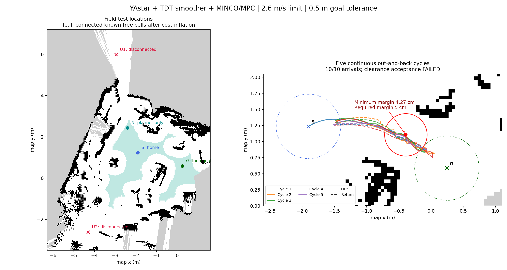

# 227_1116_remap 场地算法验证指南

本次记录基于提交 `83bafc3` 的 YAstar → TDT 平滑器 → MINCO/MPC 链路。日期：2026-11-16。所有坐标单位为米，坐标系为 `map`。

## 本次实际结论

连续完成 5 个往返、10/10 段到达，速度上限保持 2.6 m/s、加速度上限保持 7 m/s²。返回点误差为 0.3768–0.4258 m，按当前 0.50 m 到点容差通过。

**净空验收未通过。** 第 2 轮去程的最小几何包络裕量为 0.042697 m，低于已有脚本的 0.05 m 判据；峰值速度为 2.5198 m/s。Nav2 行为树恢复 0 次，控制器内部脱困进入 3 次，均退出后继续到达。另有里程计时效及控制频率不足告警，原因尚未完成归因。

同一固定起终点连续规划 5 次均成功，解析后的目标末点位移为 0。前一轮已完成 402 个功能测试，0 errors / 0 failures；本次没有修改导航源码。

[本次判定数据](results/2026-11-16_83bafc3/assessment.json) · [逐段净空数据](results/2026-11-16_83bafc3/clearance_summary.json) · [重复目标](results/2026-11-16_83bafc3/repeated_goal.json)



## 先确定这张图能测到哪里

| 点位 | 坐标 | 当前实际结果 | 用途 |
| --- | --- | --- | --- |
| S 出发/返回 | (-1.905, 1.235) | 出生点 | 每轮返回区域 |
| G 房间另一侧 | (0.245, 0.585) | 5 轮去程和返回均到达 | 往返、转弯、贴障、换目标与停车 |
| N 上侧近端 | (-2.405, 2.435) | 仅规划成功，未进行闭环行走 | 补充短程/斜向测试 |
| U1 上方走廊 | (-2.955, 5.985) | 仅规划 ABORTED；代价地图与 S 不连通 | 当前作为不可达用例 |
| U2 左下出口外侧 | (-4.305, -2.615) | 仅规划 ABORTED；代价地图与 S 不连通 | 当前作为不可达用例 |
| 左下窄口附近 | (-3.955, -1.615) | 目标格 cost=253，规划失败 | 膨胀区域/目标吸附检查 |

读取了实际 `/red_standard_robot1/global_costmap/get_costmap`，按当前 YAstar 的 `occupancy_threshold=252` 和 `treat_unknown_as_obstacle=false` 做独立连通性检查。S、U1、U2 分属不同连通区域；对应规划失败与代价地图一致。[连通性数据](results/2026-11-16_83bafc3/costmap_connectivity.json)

本次完成的是**房间内往返**。真正“出门再返回”尚未验证。下一步在 RViz 同时显示原始地图和膨胀后的全局代价地图，核对出口实际门宽、地图障碍和未知区域、机器人 footprint 与定位对齐。当前代价地图半径为 0.40 m，控制器几何包络半径为 0.33 m。先确认哪一层封住了出口，再决定修正地图或配置；地图上的不连通不等于已经证明实物通道不能通过。

当前未知格策略允许 planner 把 unknown 当可通行，场地验收另要求测试路线保持在已确认的自由区域。本次保存的原始/平滑路径按 2 mm 采样，均未进入源 PGM 的障碍格、未知格或图外。

## 按三层验收，定位问题归属

| 层 | 怎么测 | 记录什么 | 判定 |
| --- | --- | --- | --- |
| YAstar 全局规划 | 固定 start/goal，只调用 ComputePathToPose，车不走 | 是否可达、精确首尾、同目标末点稳定性、连续线段占据检查、墙钟耗时 | 已知可达应出有效路径；不连通应明确失败；同目标末点不得漂移 |
| TDT 平滑器 | 把同一条 raw path 交给 SmoothPath | 平滑前后路径、端点偏移、连续碰撞、长度/曲率、墙钟耗时 | 端点保持允许范围；平滑后路径通过独立碰撞检查 |
| MINCO/MPC 与完整速度链 | 导航到点、返回、重复换目标 | 真值/实测轨迹、停车误差、包络净空、速度、恢复次数、里程计年龄、控制周期 | 到点与净空分别过关；普通静态往返应检查每次内部脱困的原因 |

当前专用行为树的 SmoothPath 使用 `check_for_collisions=false`。平滑结果应额外检查连续碰撞。必须用规划/平滑时对应的 costmap 快照；本次保存的初始快照与后续运动时刻不相同，`assessment.json` 中 initial_costmap_overlap_samples 仅供对照，不能据此认定后续路径碰撞。

对规划耗时，同时记录插件内部报告和请求到应答的墙钟耗时。仿真钟变慢时，两者可能相差明显。本次重复规划请求的墙钟耗时约 18–43 ms，末点位移为 0；五次样本不足以给出性能上限。

## 在这个场地按以下顺序扩展

1. **短程和终点停车**：S 到原脚本 short_diagonal (-2.655, 0.135)，再返回 S；确认进入成功区域后停稳，滑出区域后能恢复跟踪。先保持现有 0.50 m 容差。
2. **房间内往返**：S ↔ G，先 5 轮，再以每次独立日志做 20 轮稳定性试验。检查去程与回程分别成功率、净空和内部脱困，不能只汇总最终到达。
3. **转弯绕障**：G → 原脚本 around_obstacles (-2.955, -0.565) → S。保存折线、平滑线、MINCO 轨迹和真实行走轨迹，检查切内弯发生在哪一层。
4. **固定目标反复重规划**：固定 S、G 连续规划至少 5 次，比较解析后末点；再做近障碍目标吸附和目标被占据的单元/仿真测试。
5. **不可达目标**：对 U1/U2 先只规划，核对连通性与失败信息。恢复出口连通性之后，再把同一坐标升级为“应可达”测试，最后做实际出门往返。
6. **实车低速复现**：先确认定位、地图、速度链和现场制动条件，再用 0.4 m/s 首次联调配置跑同一类点位。实车初始 map→odom 需要现场标定，不直接套用仿真出生点。静态路线完成后，再单独安排动态障碍及自转测试。

每次只改变一个因素。失败时先看“有没有全局路径 → 平滑路径是否有效 → 局部轨迹能否验证 → 输出速度/里程计是否及时 → 底盘实际是否执行”。

## 建议保留的验收表

| 项目 | 本次判据/范围 | 本次结果 |
| --- | --- | --- |
| 逐段到达 | SUCCEEDED 且误差 ≤ 0.50 m | 10/10；通过 |
| 回到 S 区域 | 同上，统计每一轮返回误差 | 0.3768–0.4258 m；通过当前容差 |
| 几何包络净空 | 占据格边界距离减 0.33 m，整段最小值 ≥ 0.05 m | 0.042697 m；未通过 |
| 导航速度 | 不超过当前 2.6 m/s 上限 | 峰值 2.5198 m/s |
| 静态往返稳定性 | 记录并解释所有内部脱困，目标为常规路线无需脱困 | 3 次；需排查 |
| 状态与控制周期 | 无里程计时效错误，检查 50 Hz 控制周期达成情况 | 存在告警；需排查 |
| 重规划末点稳定 | 同一目标末点位移 ≤ 1e-5 m | 5/5 成功，位移 0 |
| 真正出门往返 | 先保证出口在实际代价地图连通，再走出并返回 | 未完成 |

0.05 m 是本仓库当前仿真净空判据。真实机器人还需计入地图、定位、车体包络和制动误差。当前仿真采用二维占据格挤出的 0.8 m 障碍及真值里程计。精确回位若要求 0.1 m，应另设对应验收，并同时复测目标检查器和终点停车逻辑。

控制器 recovery_enter_count 是累计计数；不要把每个航段的最大值相加。本次“3 次”通过日志中的实际进入事件逐条统计。Nav2 行为树恢复另计，为 0。

## 复跑

在 Ubuntu 22.04 / ROS 2 Humble 工作区根目录执行。需要先构建 `srm27_minco_core`、`srm27_minco_controller`、`srm27_nav_plugins`、`srm27_nav_common`、`srm27_nav_planner`、`srm27_nav_smoother` 以及仿真依赖，并 source 工作区。Python 依赖沿用同目录的 `build_scene.py`、`verify_navigation.py` 与 `analyze_clearance.py`；无显示服务时需要 Xvfb。默认使用 CycloneDDS（`ros-humble-rmw-cyclonedds-cpp`），可通过 RMW_IMPLEMENTATION 指定已安装的 DDS 实现，所有终端保持一致。

```bash
source /opt/ros/humble/setup.bash
source install/setup.bash
export ROS_DOMAIN_ID=54
export RMW_IMPLEMENTATION=rmw_cyclonedds_cpp
VALIDATION=maps/227_1116_remap/simulation/field_validation
```

终端一启动场景：

```bash
bash "$VALIDATION/run_sim.sh"
```

终端二同样加载 ROS 环境，执行 5 个往返（参数可改为其他正整数）：

```bash
bash maps/227_1116_remap/simulation/field_validation/verify_loop.sh 5
```

脚本为每段路线设置唯一名称，避免重复点名混合多轮采样。每轮测试使用自己输出目录里的场景清单。采集后按原有几何方法计算净空，并在段数、到达、0.50 m 终点误差或 0.05 m 包络净空任一不达标时返回非零退出码。**本次保存的 4.27 cm 结果应被此入口判为 FAIL。** 这项退出码检查不涵盖内部脱困或控制周期告警，仍需结合诊断表判断完整验收状态。

输出默认写到 `log_diag/tdt_field_validation/`，仍由仓库忽略。使用 SRM_VALIDATION_OUTPUT 为每次复测指定独立目录；每个场景同时只运行一项验证任务。

```bash
SRM_VALIDATION_OUTPUT="$PWD/log_diag/loop_run_01" \
  bash maps/227_1116_remap/simulation/field_validation/verify_loop.sh 5
```

需要持续循环时执行：

```bash
bash maps/227_1116_remap/simulation/field_validation/continuous_loop.sh
```

它使用 [两点航点文件](out_and_back.yaml)，每点停 2 秒，不重试失败目标。此持续循环入口对应的原始任务配置已实跑 3 个完整往返，运行中停止服务成功。完整 5 轮的几何净空统计由独立 NavigateToPose 顺序验证入口采集。终端保持同一 ROS 域，停止循环可调用：

```bash
ros2 service call /waypoint_mission/stop std_srvs/srv/Trigger '{}'
```

脚本默认自动定位工作区。使用独立 overlay 时，可设置 SRM27_WS_DIR 与 SRM27_SETUP_FILE；ROS 环境入口可通过 SRM27_ROS_SETUP 覆盖。SIM_GUI / USE_RVIZ 默认 False。所有启动参数保持本次测试的出生点、真值里程计、原速配置和零云台自转。

## A/B 对照：分清收益来自哪一层

参数生成器保持 MINCO/MPC、速度限制、地图、行为树和到点容差一致：

| 配置 | 全局规划 | 平滑器 | 用途 |
| --- | --- | --- | --- |
| A_thetastar_simple.yaml | ThetaStar | SimpleSmoother | 原规划器基线 |
| B_yastar_simple.yaml | YAstar | SimpleSmoother | 看全局规划替换的影响 |
| C_yastar_tdt.yaml | YAstar | MinimumSnapSmoother | 完整移植链路（文件名沿用 2026-11 实验记录） |

在工作区根目录生成当前 checkout 对应的配置：

```bash
python3 maps/227_1116_remap/simulation/build_scene.py
python3 maps/227_1116_remap/simulation/field_validation/prepare_comparison.py \
  --out "$PWD/log_diag/tdt_comparison/configs"
```

生成逻辑已核对三组的差异范围，A/B 闭环对照尚未执行。每种配置都从同一出生点重启仿真，跑相同目标顺序、相同轮数。记录成功率、规划墙钟耗时、路径长度、实际净空、停车误差及内部脱困次数；路径重采样差异也要纳入记录。先完成正确性与净空，再比较速度和耗时。

例如启动 A（先结束上一套仿真）：

```bash
NAV_PARAMS_FILE="$PWD/log_diag/tdt_comparison/configs/A_thetastar_simple.yaml" \
  bash maps/227_1116_remap/simulation/field_validation/run_sim.sh
```

替换文件名即可切换 B/C。有限往返采集脚本沿用同一 smoother 实例 ID，因此可复用。

## 实车入口的准备

项目已有 `config/real/speed_limits_tdt_first_run.yaml`，把控制器、速度平滑器和 mux 的平移上限统一设为 0.4 m/s。先在实车工作空间执行预检（X/Y/YAW 替换为现场正确初值）：

```bash
./script/start_real_nav.sh --check --tdt-planner --lio --map 227_1116_remap \
  --map-to-odom X Y YAW --no-chassis-spin --no-joy \
  --speed-limits "$PWD/src/srm27_navigation/srm27_nav_bringup/config/real/speed_limits_tdt_first_run.yaml"
```

确认地图/定位、插件和实际速度档位后再去掉 --check。实车的目标坐标必须经 RViz 与现场对应关系核对。本次没有启动实车，也没有完成实车或 A/B 性能验收。

[持续循环入口验证](results/2026-11-16_83bafc3/continuous_loop_check.json) · [停止验证](results/2026-11-16_83bafc3/stop_motion_check.json)
