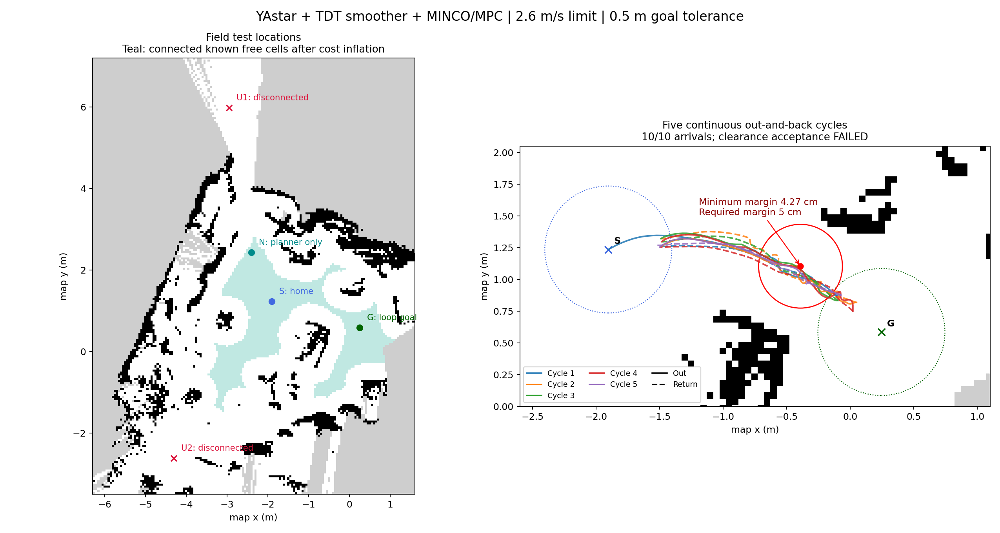

# 五轮往返结果

提交：83bafc3；路线 S(-1.905, 1.235) ↔ G(0.245, 0.585)。仿真原速 2.6 m/s，到点容差 0.50 m。

| 轮次 | 去程 | 返回 | 去程误差(m) | 返回误差(m) | 本轮最小几何包络净空(cm) |
| --- | --- | --- | ---: | ---: | ---: |
| 1 | SUCCEEDED | SUCCEEDED | 0.4325 | 0.4210 | 8.06 |
| 2 | SUCCEEDED | SUCCEEDED | 0.3042 | 0.4234 | 4.27 |
| 3 | SUCCEEDED | SUCCEEDED | 0.4229 | 0.4258 | 6.36 |
| 4 | SUCCEEDED | SUCCEEDED | 0.2784 | 0.4048 | 6.59 |
| 5 | SUCCEEDED | SUCCEEDED | 0.4309 | 0.3768 | 7.92 |

到达：10/10。几何净空：4.27 cm < 5 cm，未通过。控制器内部脱困实际进入 3 次，Nav2 行为树恢复 0 次。

另用仓库现有 --loop 入口完成 3 个完整往返，运行中停止服务成功，停止后速度指令为 0。该补验与上表的五轮几何统计分开记录。

真正出门返回仍未完成：当前试探的上方走廊和左下出口，在实际代价地图中与 S 不连通。

[场地验证指南与复跑命令](../../README.md) · [详细数据](assessment.json)

原始高频 CSV、ROS 日志和动态轨迹留在采集端的 log_diag 目录。这里保留轻量结果、诊断事件、地图连通性与图示；没有将未执行的实车或 A/B 对照计为通过。
