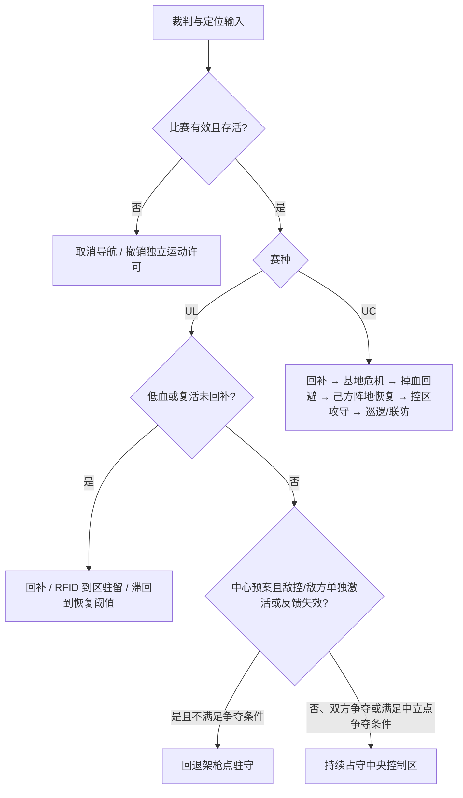

# srm27_behavior：2027 UC / UL 决策（后端）

沿用 PolarBear 的 BehaviorTree.CPP **4.6.2** + BehaviorTree.ROS2 插件框架。策略用 XML，点位和阈值用 YAML；UC、UL 分开维护。规则依据为 2027 V1.0.0（2026-10-15），裁判数据格式按 2027 通信协议 V1.0.0（2026-10-29）。

## 包分层（2026-11-24）

决策模块按仓库的 common / frontend / backend 框架拆成三个包，本文件所在的是**后端**：

| 目录 | 包 | 内容 |
|---|---|---|
| `src/decision/common/` | `srm27_behavior_core` | header-only 共享底座：航点/语义区、导航到点状态、自转参考、姿态状态 |
| `src/decision/frontend/` | `srm27_behavior_plugins` | BehaviorTree 插件（动作/条件/控制/装饰器），安装到 `share/srm27_behavior_plugins/bt_plugins` |
| `src/decision/backend/` | `srm27_behavior`（本包） | 执行服务端/客户端、裁判输入、决策树、参数、launch、现场验证脚本 |

依赖方向：`srm27_behavior` 与 `srm27_behavior_plugins` 都只依赖 `srm27_behavior_core`；
服务端在运行时按 `params/sentry_behavior.yaml` 的 `plugins: [srm27_behavior_plugins/bt_plugins]`
枚举并加载插件，不需要编译期依赖插件包。C++ 命名空间统一为 `srm27_behavior`。

## 运行与改策略

```bash
# 已有 ROS 2 Humble 工作区
colcon build --packages-up-to srm27_behavior srm27_chassis_control srm27_nav_protocol
source install/setup.bash
ros2 launch srm27_behavior srm27_behavior_launch.py target_tree:=rmul_2027 use_sim_time:=false
# UC 换 target_tree:=rmuc_2027；Gazebo 换 use_sim_time:=true
```

完整导航已有入口：

```bash
./scripts/bringup/start_sim_nav.sh --behavior rmul_2027
./scripts/bringup/start_real_nav.sh --behavior rmuc_2027
```

随包参数当前为 `dry_run=false`、`waypoints_calibrated=true`，会允许输出运动请求；观察策略时显式设置 `dry_run: true`，未完成场地标定时设置 `waypoints_calibrated: false`。先在自有 `params_file` 中按当前场地/己方颜色标定并设置 `waypoints_calibrated: true`，旁观确认后再设 `dry_run: false`。使用复制式安装时修改源码配置后须重新构建；推荐 symlink-install，或向 launch 传绝对路径 `params_file:=...`。

导航栈与 `srm_cmd_mux` 必须可用；决策不包含串口/定位/建图启动。赛前、战亡、错误赛种、零剩余时间、裁判或定位超时均取消导航并停止 mux。没有独立的哨兵建图阶段。**主动取消 ExecuteTree 后保持停止**，重新发送树目标或重启 launch 才重新执行。

| 要改什么 | 位置 |
| --- | --- |
| UC 战术优先级 | `decision_trees/rmuc_2027.xml` |
| UL 回补/控区 | `decision_trees/rmul_2027.xml` |
| 一个战术的条件/动作、比赛门控、自转仲裁 | 直接编辑对应赛制 XML 内的命名子树，附中文注释 |
| 坐标、巡逻路线 | `params/waypoints.yaml`；命名点 `named_waypoints`，连续路线 `waypoint_groups` |
| 回补阈值、早期时段、UL 中心攻守 | `params/sentry_behavior.yaml` |
| UL 架枪回退点、回位半径、受击变速约束 | `ul.fallback_waypoint`、`ul.hold_radius`、`spin.evasion_speed/max_accel/max_jerk/seed`；坐标在 `waypoints.yaml` |
| 坡道/隧道限制 | `params/rmuc_semantic_map.yaml`、`params/rmul_semantic_map.yaml` |

`waypoints_file`、`ul.fallback_waypoint`、`ul.semantic_map_file`、`uc.semantic_map_file` 都是服务端参数，在 `sentry_behavior.yaml` 中已按 `ul:` 与 `uc:` 分块维护（且兼容 `ul_*` / `uc_*` 扁平传参），支持在自有 `params_file:=...` 中覆盖。UL 固定占守 `rmul_center`，本队底盘无法上高地，不提供高地预案。修改策略参数、XML 或 YAML 后重启决策服务；**仅 `spin.*` 支持运行中热更新**。

点位表仅保留当前策略使用的点/路线；UL 只查询隧道 `tunnel`，UC 保留 `slope` / `tunnel` 地形限转。所有随包航点、区域多边形都是示例，需按当前场地 map 原点和己方颜色标定；UL 还须补充实测 `type: tunnel` 多边形，查询不到区域会继续普通自转。目标朝向单位 rad。无效路线整体拒绝，不跳过错误点继续执行。

两份 2027 XML 均采用单文件内 `SubTree`：主树只展示模块入口，所有 `BehaviorTree` 定义留在本文件，不依赖外部模块。Groot 中打开 `Project.btproj`，选择 `rmul_2027` / `rmuc_2027`，Ctrl+单击子树卡片，在独立页签中查看。UL 顶层为比赛门控、回补解虚弱、中心回退、持续占守；UC 顶层为比赛门控、回补、紧急防御、阵地攻守、巡逻兜底。所有子树调用使用 `_autoremap="true"`，全局 `{@key}` / `@key` 仍直达全局黑板；原有 Reactive 抢占顺序保持不变。服务端加载目录和 Groot 工程引用无需改动。

### Groot 查看方式

1. 关闭旧工程时选择不保存，再用 `groot2 src/decision/backend/srm27_behavior/decision_trees/Project.btproj` 重新打开磁盘版本；避免旧画布保存覆盖外部更新的 XML。
2. 在左侧 Trees 中双击带星标的 `rmuc_2027` / `rmul_2027` 主树，查看 5 / 4 个模块入口。
3. **Ctrl+单击子树卡片**，在独立页签中查看该模块；返回总览时点击上方主树页签。直接双击卡片会打开属性编辑窗口。
4. 卡片右下角 `+` 用于就地展开；日常查看保持折叠，按需进入一个模块，避免把全部子树铺回同一画布。
5. `Ctrl+0` 适配当前树到窗口，`Ctrl++` / `Ctrl+-` 缩放，`Ctrl+A` 自动排布，`Ctrl+H` 查看快捷键。

## 两套策略



回补尝试默认最多 25 秒（包括赶路与等待），失败后暂避并冷却 15 秒再尝试；UL 仍属于“回补/占守”两种主行为，不增加追敌、多机通信或补弹。`supply_timeout/supply_retry` 可调，必须结合实际路径长度标定。

**UL**：5 分钟、400 HP、750 发、100 W，无姿态、无多机通信、无局内补弹。默认只保留回补和占守；低血 150 触发、恢复到 360 离开。复活后即使血量已经抬高，也必须检测到己方补给区 RFID 才清除回补要求；若现场 RFID 读卡失效，血量满值（HP >= max_hp）作为兜底放行。弹量耗尽继续控区。控制区需要持续激活，默认驻留，不因“已占领”就离开，也不追敌丢点。

**UL 中心攻守（2027 规则适配）**：优先级为低血/复活回补 → 中心回退架枪 → 正常占守。中心由敌方完全控制（control=2）或反馈失效/过期，前往 `ul.fallback_waypoint`（默认 `rmul_center_fallback`）；若中心仍处于中立但敌方单独激活（activation=2），`ul.contest_neutral=true` 且血量健康（HP >= `ul.contest_hp_min`，默认 250）时允许主动进点争夺打断敌方进度，仅在低血或未开启争夺时保守回退。双方激活时允许返回中心参与争夺；中立/己控且无敌方单独激活时正常进点。架枪点仅为导航目标，不保证火力射界或命中收益，必须实测标定。

规则依据为 UL §3.3.4.1、§3.3.5.3 和通信协议表 1-9：中心激活状态为 `0=无人/1=己方/2=对方/3=双方`，控制权为 `0=中立/1=己方/2=对方`，二者独立。双方激活只会暂停占领进度；双方均不激活非中立控制区时进度每秒减少 1；激活状态有 2 秒失效延迟。决策不根据抵达、计时或 RFID 伪造控制权，也不假定敌方已残血。中心字段仅接受新鲜的 2027 原生 8 字节反馈，旧转发包不具备该信息。

**UL 驻守回位**：中心和回退点驻守均使用 `ul.hold_radius=0.5m`，相对预设目标坐标偏离超过此距离，下一 tick 重新发起导航；不会把 Nav2 实际停车点当成新的驻守中心，也不重置定位。范围内保持驻守，不反复发目标。Nav2 XY 到点容差应小于该半径，并实测地图栅格端点误差，否则会因无法满足驻守精度而反复纠偏。其他回补和 UC 任务仍使用原来的到点滞回。

仿真云台系 Nav2 的 XY 容差改为 `0.40m`，为驻守半径留出 `0.10m` 栅格端点误差余量，同时保留与连续巡逻 `0.35m` 过点半径的兼容；实车云台系原有 `0.20m` 配置保持原值。仿真示例架枪点仅对平面测试地图验证进退路线，不能替代实际赛场的路线、全车净空和射界标定。

**掉血随机变速**：有效 HP 相邻采样下降至少 10，反制窗口默认维持 5 秒（`spin.evasion_duration_ms=5000`），再次掉血会续时。UL 保持中心/回退目标，不另选躲避点；UC 保留原来的 `rmuc_hp_evasion` 路线。仅此反制窗口使用随机变速，移动、驻守、补给维持原恒速目标。

参考生成器提取自 `feat/ul-motion-optimization`：在 `spin.evasion_min_speed` 至 `spin.evasion_speed` 中随机选正转速目标，默认 **3~8 rad/s**。用五次多项式连接前后转速，段首尾角加速度与角加加速度均为零；每段至少随机取 0.7~1.2 秒，按 `spin.max_accel=8 rad/s²`、`spin.max_jerk=40 rad/s³` 延长到可行时长，段后随机停留 0.2~0.8 秒。随机目标、过渡时长和停留时间使它没有固定正弦周期；这不代表敌方算法无法估计或预测。

从原转速平滑进入，并在窗口结束后平滑回到恒速目标；过渡时允许低于 6 rad/s，启动和安全停车允许为零，正常变速不反转。语义区禁转、低血回补和运动门控继续优先，安全归零不等待平滑过渡。参数 `spin.evasion_period` 已由加速度/加加速度约束取代，`oscillation_period` 节点端口改为 `randomize`；UC、UL 均使用新参考，不保留正弦模式。随机转速上下限、`spin.evasion_duration_ms` 均可热改；下限在下次抽样时使用，持续时间在下次掉血时使用，正在进行的过渡保持连续。加速度、加加速度和 `spin.seed` 为启动参数，修改需重启。种子与 `match_epoch` 合成，便于复现实验，不用于保密或保证不可预测。

这些参数约束的是 `rotation_cmd` 请求。实际出口仍受 mux 的 `wz_max/wz_ramp` 限制：生产配置为 `12.0 rad/s`、`25 rad/s²`，mux 单独启动的缺省限坡为 `4.5 rad/s²`。实车还须验收负载、打滑和跟随误差，不能用参考曲线平滑代替底盘能力标定。

受击方向接口继续使用 `RobotStatus.damage_info_valid/is_attacked/armor_id/hp_deduction_reason` 和现有 `IsAttacked` 插件；聚合字段转发及断流失效已补齐。当前串口没有有效装甲伤害来源，云台没有执行接口，故不装配自动云台对齐，也不根据 HP 差分编造方向。

**UC**：回补优先，基地危机可抢占巡逻；前哨已毁时禁止自定义 `switch_position=0` 推进；低弹收缩堡垒，避免在当前没有购买下行的情况下无限等待补弹。`uc_resupply_enabled` 默认 true，仅在开赛满 1 分钟后低弹时尝试获取免费弹量；以新鲜真实弹量达到退出阈值且 RFID 在补给区为完成条件，不发送购买请求。基地危机跳过普通低弹回补。最后 30 秒不主动进行普通远程回补；复活解除虚弱的回补保留。

**UC 阵地主线**：新鲜 2027 场地反馈可用时，己方基地受侵入优先回防，己方前哨阵地失守/受侵入先恢复；己方阵地稳固且血弹足够才争夺对方前哨阵地，双方前哨均完全控制后持续占守。临时控制不当作完全控制。残局落后时的基地阵地施压由 `uc_enemy_base_enabled` 控制，默认关闭，须先验收合法路线。输入是旧报文或阵地反馈过期时回退原巡逻/堡垒预案，`decision/status.arena_valid=false` 明示信息边界。

`Sub_RmucDynamicAttackEngagement` 定义保留在 `rmuc_2027.xml` 中，主树内的调用默认注释禁用；启用时只取消主树中该 `SubTree` 调用的注释（位置仍在紧急防御之后、阵地攻守之前）。启用前应确认 `enemy_pose` 的坐标系/时间戳、当前代价地图及禁区，完成射程/视线/整车 footprint 验收。该节点只选择环上的可行栅格，不保证射击视线；最终路径由 Nav2 检查。未标许可参考库只借鉴设计，不复制实现。

## 导航与自转契约

- 自动决策使用 `decision/motion_permit` 独立许可；mux 默认要求许可，0.5 秒未收到即清零导航和驻点自转，即使 Nav2 仍在发速度。关闭门控丢弃缓存，恢复后等待新导航速度。
- 人工 `stop_all` 独立锁存，只由明确的 `resume_all` 解除。行为树不调用这两个服务。取消树/异常终止只撤销自动许可。
- `start_sim_nav.sh` / `start_real_nav.sh` 带 `--behavior` 时从 mux 启动即要求许可，不带时显式设置 `decision_required=false` 保留手动导航。直接 launch 导航默认要求许可；纯手动调试显式传 `decision_required:=false`。
- 单点用 `SendNav2Goal`，巡逻用 `NavigateThroughPoses`；2027 默认树不向 `goal_pose` 盲发。
- 每个导航 Action 外放 `NavigationTransitionGate`：先等待旧目标取消完成再发送新目标；导航拒绝/中止以 1 秒间隔重试。单次目标最多运行 `navigation_timeout=45s`；远离目的地的假成功视为失败。取消失败则终止树并锁住 mux，客户端不自动重启。
- 单点成功后保持驻留，不重复发相同目标；超过离点滞回距离后重新导航。巡逻组成功后继续下一轮。
- `navigation_completion_tolerance=0.8m` 独立于自转到点/离点滞回，按 Nav2 XY 容差与栅格端点误差标定，不能大到把远处的假成功接受为到点。
- MINCO 终点停车使用 Nav2 的实际 TF 位姿，与 GoalChecker 同源，避免里程计外推提前锁住停车。轨迹跟踪仍使用原有外推状态。
- 云台系入口的 `OmniStoppedGoalChecker` 支持现有 `stateful=true` 配置：同一目标先捕获 XY，再等平动刹停，避免漂出容差几毫米就无法完成；reset/目标改变会清除捕获。
- 行进转速通过 `rotation_cmd` 直接进入 mux；MINCO 在云台系只输出平移。到点 Action 已完成或补给 RFID 驻留时，通过 `behavior/hold_spin` (`std_msgs/Float64`) 向 mux 续租原地自转；只有导航输入为零/超时时可接管 wz，覆盖行进自转请求、绝不提供平移。租约 0.2 秒失效，`stop_all` 和决策许可门控同时清除所有输入。
- `spin.moving_speed=2.5`、`arrived_speed=7.0`，到点/离点半径默认 `0.35/0.55 m`；Nav2 成功时记录实际停车点，兼容栅格端点与 Nav2 容差；之后仍检查离点漂移。底盘转速受 mux 与硬件限幅。

```bash
ros2 topic echo /decision/status
ros2 topic echo /behavior/spin_state
python3 src/decision/backend/srm27_behavior/scripts/check_decision.py --output-topic cmd_vel_chassis
ros2 topic echo /cmd_vel_chassis          # 实车出口；仿真看 /<namespace>/cmd_vel_sim
ros2 param set /srm27_behavior_server spin.arrived_speed 8.5
ros2 param set /srm27_behavior_server spin.moving_speed 1.5
ros2 service call /srm_cmd_mux/stop_all std_srvs/srv/Trigger
```

**姿态边界**：`sentry/desired_posture` 是本地请求，`current_posture` 也是请求侧估计；当前串口没有姿态、买弹、确认复活的下行/确认闭环。5 秒冷却和各姿态累计时间仅约束请求，不证明裁判系统已执行。不编造 2027 下行帧或强化姿态编号。

## 自转转速测试（dev）

`decision_trees/dev_rm.xml` 里的 `test_spin_speed` 只用于空场/仿真标定，不参与比赛策略：

| 树 | 行为 |
| --- | --- |
| `test_spin_speed` | 没有活动 Nav2 目标、已到点或目标被取消/中止 → 原地 `-2 rad/s`；Nav2 目标 `ACCEPTED/EXECUTING` → 导航中 `-6 rad/s`（负值 = 反向自转） |

它**不自己下发目标**：目标用 RViz 的 “Nav2 Goal”（或任何节点）直接发给 `navigate_to_pose`。
服务端订阅 `<nav_action_name>/_action/status`（默认 `navigate_to_pose`），把最新目标状态
映射成黑板 `nav_action_state`（0=无目标/取消/中止，1=导航中，2=到点）、
`nav_action_active`、`nav_action_arrived`，测试树只读这三个键。因此可以直接在 RViz
里点目标观察 6/2 切换；目标失败/取消后自动回到 2，不需要改 XML 里的坐标。

转速 `-2.0 / -6.0` 写死在 XML 里（负值 = 反向自转；`PublishRotationCmd` 会把幅值喂给
平滑参考、只把符号放在出口 `angular.z` 上），不受 `spin.*` 热调参数影响；实际出口仍受 `srm_cmd_mux`
的 `wz_max` / `wz_ramp` 限幅（生产配置 `12.0 rad/s`、`25 rad/s²`）。树里会置
`@motion_allowed=true`，但不含比赛门控，禁止在正式比赛选择；外部目标不会经过
`SendNav2Goal`，所以必须用 `--test-behavior`（mux 不要求决策许可），`--behavior` 下
`navigation_ready` 不会被外部目标置位，mux 会把运动清零。

```bash
# --test-behavior：脚本自动把 mux 设为 decision_required=false，并打印安全警告
./scripts/bringup/start_real_nav.sh --test-behavior
./scripts/bringup/start_sim_nav.sh --test-behavior

# 然后在 RViz 里用 “Nav2 Goal” 点一个空闲目标：
#   无目标/到点 → -2 rad/s；导航中 → -6 rad/s；取消/失败 → 回到 -2 rad/s
ros2 topic echo /behavior/spin_state                 # TEST_MOVING_SLOW / TEST_HOLD_FAST
ros2 topic echo /cmd_vel_chassis                     # 实车；仿真看 /red_standard_robot1/cmd_vel_sim
```

`--test-behavior` 与 `--behavior` 的区别：后者走正常决策许可门控（正式比赛/带裁判输入）；
前者让 mux 不要求 `decision/motion_permit`，方便空场或架起车辆时验证。它同时给服务端传
`enforce_mux_guard:=false`，否则服务端启动树后会把 mux 的 `decision_required` 改回 `true`
（无裁判输入时所有输出都会被清零）。`--test-behavior` 也可以带树名覆盖默认的
`test_spin_speed`。XML 在服务端启动时从 install 目录加载：symlink-install 改完即生效，
复制式安装需重新构建；`enforce_mux_guard` / `nav_action_name` 是服务端启动参数，改动后需重启服务端。

## 裁判协议兼容

`EventData` 包含 2027 R/B 阵地控制/激活数组和 `battlefield_valid`，并分别提供 UL 中心激活 `center_gain_point_status`、控制权 `center_control` 及有效位 `center_control_valid`；`AllyRobotHP` 包含 R/B 前哨 HP、双方控制度和 `control_score_valid`，对应通信协议 V1.0.0（2026-10-29）表 1-8/1-9。旧转发包保留原字段，新有效位为 false；速度下行仍为 19 字节。ROS 消息定义更新后，生产者和消费者须一起重新构建，避免混用旧消息类型。

## 黑板与接口

| 输入/状态 | 主要字段 / 来源 |
| --- | --- |
| `referee/game_status` | `game_type`、`game_progress`、`remain_time`；UC=1、UL=4、比赛阶段=4 |
| `/srm/sefdefined` | 原始身份、HP、电源；仅 7/107，HP 合法且底盘上电才放行；可用 `status_topic` 重映射 |
| `referee/robot_status` | 仅补充热量/受击信息，聚合消息不能刷新 HP 或弹量的新鲜度 |
| `referee/projectile_allowance` | 弹量与金币，独立新鲜度；未收到或断流不当作 0 发 |
| `referee/rfid_status` | 己方补给、中心、堡垒；超时清除缓存 |
| UC 的 `ally_robot_hp` / `switch_position` | 基地、前哨血量 / 自定义推进开关；UL 策略不依赖这些输入 |
| `nav_mapPose` | 新鲜 `map → gimbal_yaw` TF（由 `robot_base_frame` 配置）；仅允许 map 同帧 odometry 作为替代，拒绝把 odom 当 map |
| `inputs_ready` | game/原始身份/map pose 新鲜度守卫，默认 3 秒；相同 TF/odometry 时间戳不能续命 |
| `arena_valid` / `score_valid` | 2027 8 字节场地事件 / 24 字节血量控制度，独立超时；R/B 场地标识按原始身份映射 |
| `match_epoch` / `needs_supply` | 新局清除历史滞回/姿态预算；复活回补锁存 |
| `nav_arrived` / `nav_goal_finished` | 距离滞回 / Action 成功，二者分别记录 |
| `nav_action_state` / `nav_action_active` / `nav_action_arrived` | 外部 Nav2 `<nav_action_name>/_action/status`（默认 `navigate_to_pose`）：0=无目标/取消/中止，1=导航中，2=到点；`test_spin_speed` 用 |

## 验证

```bash
# 本机没有 ROS：首次会构建 Humble 镜像
./src/decision/backend/srm27_behavior/scripts/validate_decision.sh --docker
# 包含真实 Nav2/MINCO + fakeyaw + mux 的平面运动闭环仿真
./src/decision/backend/srm27_behavior/scripts/validate_decision.sh --docker --nav2
# Ubuntu 22.04 / ROS Humble 开发机或上位机，测试与在役 ROS 域隔离
./src/decision/backend/srm27_behavior/scripts/validate_decision.sh --nav2
```

默认构建只涉及决策、接口和 mux。回归使用生产服务端、生产 XML、真实 ROS Action、真实 mux，替代边界只有裁判输入、定位和 Nav2；`--nav2` 再把 Nav2 替代物换成真实 Nav2/MINCO，仅保留平面运动模型和裁判输入。测试不连接串口、不移动实车。

验证在本地运行，不使用 GitHub CI。输出位于已忽略的 `.cache/decision-validation/results/`：JUnit、逐场景 manifest、服务端/导航/mux 日志；决策核心、协议和底盘 gtest 由 CTest 执行。

上机场地验收顺序：

1. 先在隔离 ROS 域运行上述本地回归，核对 Action 抢占、断流和停机行为。
2. 按当前场地与己方颜色标定航点、语义区域、RFID 有效范围和 Nav2 XY 容差；核对 `map → gimbal_yaw` 与目标坐标同源。
3. 静止核对电控真实上报的赛种、阶段、HP、弹量、阵地状态及新鲜度。完整 UC 阵地主线需要 2027 的 8/24 字节反馈，旧报文只走降级预案。
4. 完成 Gazebo 场地、传感器与避障验收；获得现场运动授权后，再按车辆限幅验收人工停车、取消、低速往返、自转及定位断流。

更新 vendored BehaviorTree.ROS2 时，保留本分支的 Action 回调组、接收确认、高频反馈和退出生命周期修复，并重新运行相应回归。

Gazebo 传感器、真实定位漂移、电控协议、场地标定与真车运动均需要单独验收，平面闭环不能替代这些结果。
