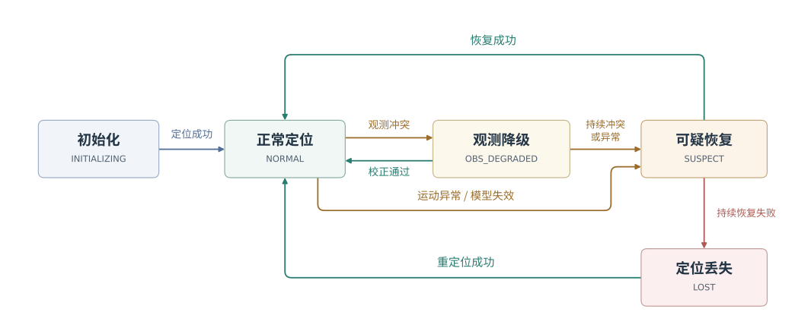

# Localization Backend · 定位后端


本包是 Z-Localization 上游 `src/backend` 在本工作区的**迁入版**（上游基线提交 `76e1263`；
迁入时只对照阅读过上游检出，运行期**不依赖**任何上游工作区路径），把前端里程计与先验地图、
回环、UWB 位置观测结合，输出全局位姿、速度、协方差和定位状态；包内也提供地图处理与车体外参标定工具。

> ⚠ **实验模式，默认关闭。** 本工作区的导航默认链路仍是 `--lio`（静态 `map->odom`）
> / `--reloc`（small_gicp）/ `--slam`。backend 只在显式 `--zloc-backend` 时启用，
> 且必须先通过仿真与实车验收。接口与所有权契约见
> [`docs/architecture/localization_backend.md`](../../../../docs/architecture/localization_backend.md)。

[本工作区的改造](#本工作区的改造) · [项目结构](#项目结构) · [环境与依赖](#环境与依赖) ·
[快速开始](#快速开始) · [参数配置](#参数配置) · [对外接口](#对外接口) ·
[地图与标定工具](#地图与标定工具) · [致谢](#致谢)

## 本工作区的改造

迁入基线主要改包名、构建、安装路径和接线。2026-11-19 增加先验/回环/UWB 独立开关，
并拆分先验与运行描述子库，使先验跟踪和运行轨迹回环能够共存：

| 项 | 上游 | 本工作区 |
| --- | --- | --- |
| 包名 / CMake project | `backend` | `srm27_zlocalization_backend` |
| 节点可执行 | `backend_node` | `srm27_zlocalization_backend_node` |
| 工具可执行 | `build_pcd_map_bundle` 等 6 个 | 统一前缀 `srm27_zlocalization_backend_*` |
| 构建资源 | 仓库根 `../../cmake`、`../../config`、`../../LICENSE` | 包内自持：`cmake/`、`config/`、`LICENSE` |
| 配置 | 仓库根 `config/backend.yaml` | `config/backend.yaml` + 两个平台 profile |
| C++ namespace | `backend` | 不变（可选） |
| 输入话题 | 绝对名 `/frontend/frame` 等 | 相对名 `frontend/frame`（随 namespace 解析） |
| `map->body` / legacy 输出 / `world_cloud` | 默认开 | **默认关**（本工作区无消费者，且会多发一条 TF） |
| 先验 / 回环 / UWB | 先验模式强制关闭回环 | 三项默认关，可独立选择或同时启用 |
| 先验地图/轨迹目录 | 相对进程 CWD | 必须由入口给绝对路径，否则 configure 阶段报错 |
| reset 服务 | 直连前端 `/zlio/reset_internal` | 走适配层代理 `zlocalization/reset_frontend` |

接线侧（`srm27_localization_adapter` 的 `zlocalization_backend_adapter.py`）负责：
把 `FrontendFrame`/`FrontendOdometry` 的位姿左乘 `T_off`、按点约定旋转协方差、
校验 frame/时间戳契约、转发 `FrontendSession`，并把 reset 回复里的坐标边界改写成
**恒等边界**（适配后 odom 连续，backend 不再做第二次补偿）。
这些设计的原因见
[接入契约](../../../../docs/architecture/localization_backend.md)。

## 项目结构

```text
src/localization/backend/srm27_zlocalization_backend/
├── README.md
├── include/backend/             核心接口、配置与数据类型
├── src/                         因子图、配准、回环、重定位与 UWB 融合
├── apps/                        ROS 输入、参数、服务与发布
├── tools/                       地图处理和车体外参标定
├── launch/
│   ├── backend.launch.py        定位后端启动入口
│   └── body_calibration.launch.py  车体外参标定入口
├── rviz/backend.rviz            RViz 配置
├── docs/
│   ├── parameters.md            完整参数列表与调参建议
│   └── assets/                  状态转移图
├── test/                        单元、集成、工具与 ROS 测试
├── cmake/Warnings.cmake          包内自持的编译告警配置
├── config/
│   ├── backend.yaml              算法基线（迁入版，见"配置"一节）
│   ├── srm27_localization_real.yaml
│   └── srm27_localization_sim.yaml
├── LICENSE                       GPL-2.0-only（上游原文）
├── CMakeLists.txt
└── package.xml
```

运行参数在包内 `config/` 下；`srm27_nav_bringup` 的 `localization_launch.py` 会按平台
选 profile 并把绝对路径的先验地图包传进来。

## 环境与依赖

| 类别 | 依赖 |
| --- | --- |
| 系统环境 | Ubuntu 22.04、ROS 2 Humble |
| 编译与构建 | C++ ≥ 17、CMake ≥ 3.16、ament_cmake |
| C++ 库 | GTSAM 4.2.x、Eigen、PCL、nanoflann、oneTBB、OpenMP C++、Threads |
| ROS 包 | rclcpp、std_msgs、std_srvs、geometry_msgs、nav_msgs、sensor_msgs、visualization_msgs、tf2、tf2_ros、tf2_eigen、pcl_conversions、message_filters |
| 工作区包 | localization_interfaces |
| 启动与显示 | launch、launch_ros、ament_index_python、rviz2、PyYAML |
| 测试依赖 | ament_cmake_gtest、ament_cmake_pytest、launch_testing_ament_cmake、rclpy、rcl_interfaces、domain_coordinator、sensor_msgs_py、NumPy |

GTSAM 被**硬锁在 4.2.x**（`CMakeLists.txt` 拒绝 ≥4.3，`package.xml` 写
`version_gte="4.2.0" version_lt="4.3.0"`）。本机没有 root 时用仓库脚本装到用户目录：

```bash
./scripts/setup/install_gtsam_4_2.sh    # 默认 ~/.local/gtsam-4.2.0
# 家目录不可写时装到工作区（本机现有安装；deb 已在 .deps 时可离线复用）：
GTSAM_PREFIX=$PWD/.deps/gtsam-4.2.0 \
GTSAM_MIRROR=file://$PWD/.deps ./scripts/setup/install_gtsam_4_2.sh
```

构建/运行时不单独 source `env.sh`：`scripts/setup/env_srm27.sh` 会按
`SRM27_GTSAM_PREFIX` → `~/.local/gtsam-4.2.0` → `.deps/gtsam-4.2.0` 探测前缀，
并导出 `GTSAM_DIR` / `LD_LIBRARY_PATH`。

## 快速开始

```bash
# 单独起定位后端（通常由 srm27_nav_bringup/localization_launch.py 代为启动）
ros2 launch srm27_zlocalization_backend backend.launch.py \
  config_file:=$(ros2 pkg prefix srm27_zlocalization_backend)/share/srm27_zlocalization_backend/config/srm27_localization_real.yaml \
  mode:=localization \
  prior_map:=/absolute/path/to/map_bundle \
  sensor_frame:=livox_imu \
  rviz:=true

# 车体外参标定（固定外参假设，本车云台不适用；仅诊断用）
ros2 launch srm27_zlocalization_backend body_calibration.launch.py
```

本工作区的正式入口是脚本（会自动做互斥检查）：

```bash
./scripts/bringup/start_real_nav.sh --lio --lio-frontend zlio \
  --zloc-backend --zloc-prior --zloc-map /absolute/path/to/map_bundle
./scripts/bringup/start_sim_nav.sh --lio --zloc-backend --zloc-prior --zloc-map /absolute/path/to/map_bundle
```

三个功能开关 `--zloc-prior`、`--zloc-loop`、`--zloc-uwb` 独立，省略即关闭；
`--zloc-map` 只指定地图目录，不能代替 `--zloc-prior`。三项都省略时 backend 只传播 LIO，
没有先验地图或 UWB 的绝对定位约束。实车与仿真脚本语义相同。

```bash
./scripts/bringup/start_real_nav.sh \
  -m "$PWD/maps/227_1113pro/227_1113pro.yaml" \
  --lio --lio-frontend zlio --zloc-backend \
  --zloc-prior --zloc-loop --zloc-uwb \
  --zloc-map "$HOME/srm_nav_27_data/zlocalization/map_bundles/227_1113pro"
```

`--zloc-config /absolute/path/to/site.yaml` 可选，用于传入现场 UWB 配置；支持 YAML `extends`。
导航入口的三个开关始终覆盖 YAML 中的 `enabled`，因此即使 YAML 写 true，省略开关仍关闭。
直接启动 `backend.launch.py` 则支持 `prior_enabled`、`loop_enabled`、`uwb_enabled`，默认 `config`
表示沿用显式 YAML / 旧 `mode` 设置；发布的 YAML 中三项默认均为 false。

先验恢复/跟踪仅访问不可变先验库，回环仅访问当前运行轨迹库，两路约束进入同一个后端图。
回环打开后自动令 `graph.fixed_lag_seconds=0` 并保留运行关键帧，内存随轨迹增长；
关闭回环时，先验模式仍使用有界图窗口和最新运行锚。不会新增第二个 `map→odom` 发布者。

UWB 开关只启用接入与融合；话题、`frame_id`、坐标对齐、天线杆臂、时间偏置仍须按实际硬件配置。
迁入的数值不是本车已标定结果。当前 UWB 因子使用固定传感器—天线杆臂；若天线在底盘、
LiDAR/IMU 在旋转云台上，必须核对动态几何，不能仅打开开关就认为云台转动已被补偿。
无先验时在线 UWB 坐标对齐/时间标定会关闭，使用配置的固定对齐；UWB-only 启动还需有可观测运动。

构建与测试：

```bash
source scripts/setup/env_srm27.sh     # 含 GTSAM_DIR；GTSAM 未装也能 source，只是 backend 构建会失败
colcon build --packages-select srm27_zlocalization_backend
colcon test  --packages-select srm27_zlocalization_backend && colcon test-result --verbose
```

> 本机的用户级 `pytest`（9.x）与 ROS 的 `launch_testing` pytest 插件不兼容，
> 跑 `colcon test` 时需要 `PYTHONNOUSERSITE=1`（用系统 pytest 6.2）；
> 若 shell 里还 source 了带旧 `libusb` 的第三方前缀（如 `/opt/MVS`），
> 跑 PCL 相关测试前要把它从 `LD_LIBRARY_PATH` 里去掉。

## 参数配置

完整参数列表与调参建议见 [参数文档](docs/parameters.md)。

## 对外接口

### 输入话题

下表列出默认话题名。`common.frontend` 决定使用哪组接口，话题名可分别配置。ZLIO 消息定义见
[localization_interfaces](../localization_interfaces/README.md)。

| 话题 | 类型 | QoS | 内容 / 条件 |
| --- | --- | --- | --- |
| `frontend/frame` | `localization_interfaces/msg/FrontendFrame` | reliable，50 | `zlio` 模式下，同一次观测的位姿与局部去畸变点云（本工作区由适配层发布，相对名） |
| `frontend/odometry` | `localization_interfaces/msg/FrontendOdometry` | reliable，200 | `zlio` 模式的高频预测（同上） |
| `frontend/session` | `localization_interfaces/msg/FrontendSession` | reliable，1，transient local | `zlio` 模式的进程身份、代次、恢复请求与处理失败通知（同上） |
| `/Odometry_scan_end` | `nav_msgs/msg/Odometry` | best effort，50 | `legacy` 模式用于同步的里程计 |
| `/cloud_registered` | `sensor_msgs/msg/PointCloud2` | best effort，50 | `legacy` 模式用于同步的点云 |
| `/Odometry` | `nav_msgs/msg/Odometry` | SensorDataQoS | `legacy` 模式的高频里程计 |
| `/uwb_pose` | `geometry_msgs/msg/PoseStamped` | reliable，10 | UWB 天线在 `uwb.frame` 坐标系中的原始位置；由 `uwb.enabled` 启用 |

输入位姿以 `common.odom_frame` 为参考，描述 `common.sensor_frame` 的位置和姿态。
ZLIO 点云位于传感器坐标系，时间戳须与同一消息内的里程计一致。

### 输出话题

`~/` 在默认节点名下表示 `/backend_node/`。QoS 中的数字表示 keep-last 队列深度；
未标注 transient local 的话题使用 volatile，不向新订阅者补发历史消息。

| 话题 | 类型 | QoS | 内容 / 条件 |
| --- | --- | --- | --- |
| `/localization/odometry` | `nav_msgs/msg/Odometry` | reliable，200 | `zlio` 模式的 map 系传感器位姿、传感器系速度及协方差 |
| `~/localization_pose` | `geometry_msgs/msg/PoseWithCovarianceStamped` | reliable，20 | map 系车体位姿及协方差 |
| `~/localization_state` | `std_msgs/msg/String` | reliable，1，transient local | 定位状态、可信标记、代次、输出版本及故障信息 |
| `/localization/lio_world_cloud` | `sensor_msgs/msg/PointCloud2` | reliable，1 | map 系实时点云；由 `output.world_cloud` 控制 |
| `~/prior_map` | `sensor_msgs/msg/PointCloud2` | reliable，1，transient local | 先验地图显示，由 `visualization.publish_prior_map` 控制 |
| `~/runtime_map` | `sensor_msgs/msg/PointCloud2` | reliable，1，transient local | 运行地图显示，由 `visualization.publish_runtime_map` 控制 |
| `~/odom_path` | `nav_msgs/msg/Path` | reliable，1，transient local | 本次前端重置后的原始里程计轨迹，已转换到 map 系；由 `visualization.publish_paths` 控制 |
| `~/optimized_path` | `nav_msgs/msg/Path` | reliable，1，transient local | map 系优化轨迹；由 `visualization.publish_paths` 控制 |
| `~/loop_edges` | `visualization_msgs/msg/Marker` | reliable，1，transient local | 回环连线；由 `visualization.publish_paths` 控制 |
| `~/map_axes` | `visualization_msgs/msg/Marker` | reliable，1，transient local | 地图关键帧坐标轴；由 `visualization.publish_map_axes` 控制 |
| `~/uwb_position` | `visualization_msgs/msg/Marker` | reliable，1，transient local | UWB 推算的 map 系车体位置；由 `visualization.enabled` 控制 |
| `~/localization_status` | `visualization_msgs/msg/Marker` | reliable，1，transient local | 定位状态文字标记；由 `visualization.enabled` 控制 |
| `~/debug/aligned_source` | `sensor_msgs/msg/PointCloud2` | reliable，1，transient local | 最近一次配准后的源点云；由 `visualization.publish_debug_registration` 控制 |
| `~/debug/target` | `sensor_msgs/msg/PointCloud2` | reliable，1，transient local | 最近一次配准的目标点云；由 `visualization.publish_debug_registration` 控制 |
| `/tdt_lio_pose` | `geometry_msgs/msg/PoseStamped` | SensorDataQoS | 兼容车体位姿；由 `output.legacy.publish_pose` 控制 |
| `/tdt_lio_twist` | `geometry_msgs/msg/TwistStamped` | SensorDataQoS | 兼容车体速度，在 map 系表达；由 `output.legacy.publish_twist` 控制 |
| `/tdt_lio_path` | `nav_msgs/msg/Path` | reliable，1 | 兼容路径；由 `output.legacy.publish_path` 控制 |
| `/LAM_danger_situation` | `std_msgs/msg/Int16` | reliable，2 | 兼容危险码：可信状态为 `0`，其余为 `9` |
| `/tf` | `tf2_msgs/msg/TFMessage` | tf2 默认 QoS | map → odom；兼容输出可另发布 map → body |

兼容输出的总开关为 `output.legacy.enabled`，话题名通过 `output.legacy.*_topic` 配置。

### 标定与 ROS 通用话题

| 话题 | 类型 | 方向 / 条件 |
| --- | --- | --- |
| `/odometry` | `nav_msgs/msg/Odometry` | 车体标定节点订阅，SensorDataQoS；由标定参数 `odom_topic` 配置 |
| `/tf`、`/tf_static` | `tf2_msgs/msg/TFMessage` | 标定节点与 RViz 订阅；标定节点按里程计时刻查询 map → odom |
| `/clicked_point` | `geometry_msgs/msg/PointStamped` | RViz 的选点工具发布 |
| `/clock` | `rosgraph_msgs/msg/Clock` | 使用仿真时间时订阅 |
| `/parameter_events` | `rcl_interfaces/msg/ParameterEvent` | ROS 参数事件 |
| `/rosout` | `rcl_interfaces/msg/Log` | 节点日志；运行期领域层日志（修正/回环等）走节点 logger，也会出现在这里 |

> 启动期的配置覆盖日志（`configuration override: ...`）在 logger 安装前打印，只走 stdout；
> 运行期的 `global correction committed` / `loop scan-to-map accepted` 等经节点 logger 进
> `/rosout`，供 `debug_tools/plot_backend_correction.py` 等诊断工具解析。

标定结果会在终端显示，并给出可填入 YAML 的配置片段。

### 服务

| 服务 | 类型 | 方向 / 含义 |
| --- | --- | --- |
| `~/save_map` | `std_srvs/srv/Trigger` | 保存运行轨迹地图包至 `trajectory.save_directory`；用于建图模式 |
| `~/relocalize` | `std_srvs/srv/Trigger` | 在 `LOST` 状态下请求重定位，收到新的有效帧后执行 |
| `localization_reset` | `std_srvs/srv/Trigger` | 发起前后端协调重置；`success=true` 表示请求已接受（相对名，随 namespace） |
| `zlocalization/reset_frontend` | `localization_interfaces/srv/ResetFrontend` | 后端调用的前端重置服务，由 `reset.service` 配置；本工作区由适配层代理到 `/zlio/reset_internal` 并改写坐标边界 |

手动调用 `/localization_reset` 时，若前端无法提供暖重置前后的坐标变换，后端会按机器人保持静止来衔接位姿。
因此，调用时须保证整个重置期间停车。自动冷恢复需要重新通过先验地图匹配或 UWB 对齐确定全局位姿；
已有轨迹、且无绝对定位来源的纯建图模式会保持 `LOST`。
普通前端处理失败会使后端冻结输出，等待显式重置或新前端进程接入，不会自动反复重启。

### 定位状态

[](docs/assets/state-transitions.svg)

| 状态 | 含义 | `pose_trusted` |
| --- | --- | --- |
| `INITIALIZING` | 等待建立初始全局位姿 | `false` |
| `NORMAL` | 正常定位 | `true` |
| `OBS_DEGRADED` | 全局观测与预测冲突，但连续次数未达到阈值，继续信任当前位姿 | `true` |
| `SUSPECT` | 连续观测冲突、速度异常或匹配模型不再适用，正在尝试恢复 | `false` |
| `LOST` | 定位丢失，等待或尝试重定位 | `false` |

`localization_state` 使用分号分隔的 `key=value` 文本，包含定位状态、可信标记、重置代次和故障信息。
进入 `SUSPECT` 或 `LOST` 后，若已有可信位姿，输出会冻结在该位姿；兼容话题和世界点云是否继续发布由各自开关决定。

## 地图与标定工具

| 程序（迁入后带包名前缀） | 功能 |
| --- | --- |
| `srm27_zlocalization_backend_build_pcd_map_bundle` | 从全局 PCD 模拟局部扫描，生成关键帧与描述子地图包 |
| `srm27_zlocalization_backend_transform_map_bundle` | 通过刚体变换、四点定轴或目标地图配准转换地图坐标 |
| `srm27_zlocalization_backend_filter_map_bundle` | 依据参考点云过滤关键帧，或导出参考地图 |
| `srm27_zlocalization_backend_clean_map_bundle` | 根据多帧扫描记录的可见空间，清理动态物体留下的地图残影 |
| `srm27_zlocalization_backend_rebuild_scan_context_descriptors` | 重建地图包中的 Scan Context 描述子 |
| `srm27_zlocalization_backend_body_calibration_node` | 标定传感器到车体的旋转及水平偏移 |

本工作区生成先验地图包的完整示例（已在 `maps/pcd/227_1113pro_mapframe.pcd` 上验证）：

```bash
ros2 run srm27_zlocalization_backend srm27_zlocalization_backend_build_pcd_map_bundle \
  --input maps/pcd/227_1113pro_mapframe.pcd --out-bundle /abs/map_bundles/227_1113pro \
  --x-min -8 --x-max 4.5 --y-min -7.6 --y-max 10.1 \
  --sensor-z 0.3464 --query-step 2.0 --bundle-step 1.5 \
  --map-voxel 0.15 --scan-voxel 0.15 --sc-lidar-height 0.3464
```

先验地图须使用关键帧地图包，包含 `keyframes.txt`、`clouds/` 和所选描述子的数据文件。
`map.pcd` 是可选的全局显示点云。各工具选项见[参数文档](docs/parameters.md#离线工具参数)。

> ⚠ 建包参数必须与 `config/backend.yaml` 的 `common.scan_context.*` **逐位一致**：
> `--sc-lidar-height`（不显式给时等于 `--sensor-z`，默认 0.3464）要对上
> `lidar_height`，`--sc-rings/--sc-sectors/--sc-max-radius/--sc-downsample/--sc-augment-count`
> 同理。不一致时 backend 启动就是 `FATAL: failed to load Scan Context descriptors`
> （`storage.cpp` 按 1e-6 比较几何配置），用相同参数重建地图包即可。

## 许可证

本包整体继承上游 **GPL-2.0-only**（见包内 `LICENSE`），第三方组件保留各自许可证。
GPL 代码进入本仓库即意味着：仓库发布、产品分发与后续维护责任由本队承担，
在集成到对外分发的产品前需要先过一遍合规评审。

## 致谢

感谢以下开源项目与研究工作提供的算法思路和工程参考。

| 项目 / 研究工作 | 参考与启发 |
| --- | --- |
| [GTSAM / iSAM2](https://github.com/borglab/gtsam) | 因子图建模、增量求解与边缘协方差计算 |
| [Scan Context](https://github.com/gisbi-kim/scancontext) / [Scan Context++](https://github.com/gisbi-kim/scancontext_tro) | 地点描述子、航向匹配与平移增强检索 |
| [G-PROBE](https://arxiv.org/abs/2607.06782v1) | 跨视场地点识别、概率占据描述与航向候选验证 |
| [PCM](https://github.com/MIT-SPARK/Kimera-RPGO#related-publications) | 回环测量的成对一致性与一致集合筛选思路 |
| [FreeDOM](https://github.com/LC-Robotics/FreeDOM) | 基于保守自由空间与可见性证据的动态残影清理 |

同时感谢 ROS 2、PCL、Eigen、nanoflann、oneTBB 和 OpenMP 生态的维护者。

## 维护者

上游作者 mozihe · [zhujunheng2005@gmail.com](mailto:zhujunheng2005@gmail.com)。
本工作区的迁入与接线维护见 `docs/architecture/localization_backend.md` 与
`docs/records/2026-11-16-zlocalization-backend-migration.md`。
