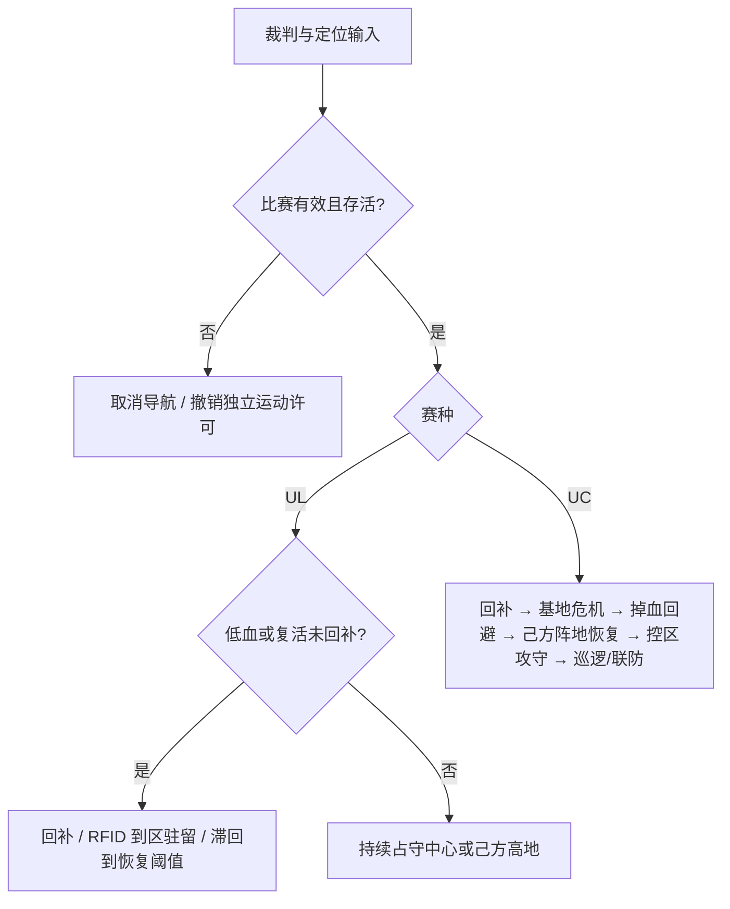

# srm27_behavior：2027 UC / UL 决策

沿用 PolarBear 的 BehaviorTree.CPP **4.6.2** + BehaviorTree.ROS2 插件框架。策略用 XML，点位和阈值用 YAML；UC、UL 分开维护。规则依据为 2027 V1.0.0（2026-10-15），裁判数据格式按 2027 通信协议 V1.0.0（2026-10-29）。

## 运行与改策略

```bash
# 已有 ROS 2 Humble 工作区
colcon build --packages-up-to srm27_behavior srm27_chassis_control
source install/setup.bash
ros2 launch srm27_behavior srm27_behavior_launch.py target_tree:=rmul_2027 use_sim_time:=false
# UC 换 target_tree:=rmuc_2027；Gazebo 换 use_sim_time:=true
```

完整导航已有入口：

```bash
./script/start_sim_nav.sh --behavior rmul_2027
./script/start_real_nav.sh --behavior rmuc_2027
```

默认 `dry_run=true`，仅输出策略状态；`waypoints_calibrated=false` 会保持门控。先在自有 `params_file` 中按当前场地/己方颜色标定并设置 `waypoints_calibrated: true`，旁观确认后再设 `dry_run: false`。使用复制式安装时修改源码配置后须重新构建；推荐 symlink-install，或向 launch 传绝对路径 `params_file:=...`。

导航栈与 `srm_cmd_mux` 必须可用；决策不包含串口/定位/建图启动。赛前、战亡、错误赛种、零剩余时间、裁判或定位超时均取消导航并停止 mux。没有独立的哨兵建图阶段。**主动取消 ExecuteTree 后保持停止**，重新发送树目标或重启 launch 才重新执行。

| 要改什么 | 位置 |
| --- | --- |
| UC 战术优先级 | `behavior_trees/rmuc_2027.xml` |
| UL 回补/控区 | `behavior_trees/rmul_2027.xml` |
| 一个战术的条件/动作 | `behavior_trees/modules/*.xml` |
| 坐标、巡逻路线 | `params/waypoints.yaml`；命名点 `named_waypoints`，连续路线 `waypoint_groups` |
| 回补阈值、早期时段、UL 中心/高地预案 | `params/sentry_behavior.yaml` |
| 坡道/隧道限制 | `params/rmuc_semantic_map.yaml`、`params/rmul_semantic_map.yaml` |

`waypoints_file`、`ul_control_waypoint`、`ul_semantic_map_file`、`uc_semantic_map_file` 都是服务端参数，支持在自有 `params_file:=...` 中覆盖。UL 默认 `rmul_center`，改 `rmul_home_highland` 即用己方高地控区预案。修改策略参数、XML 或 YAML 后重启决策服务；**仅 `spin.*` 支持运行中热更新**。

所有随包航点、区域多边形都是示例，需按当前场地 map 原点和己方颜色标定。目标朝向单位 rad。无效路线整体拒绝，不跳过错误点继续执行。

## 两套策略



回补尝试默认最多 25 秒（包括赶路与等待），失败后暂避并冷却 15 秒再尝试；UL 仍属于“回补/占守”两种主行为，不增加追敌、多机通信或补弹。`supply_timeout/supply_retry` 可调，必须结合实际路径长度标定。

**UL**：5 分钟、400 HP、750 发、100 W，无姿态、无多机通信、无局内补弹。默认只保留回补和占守；低血 150 触发、恢复到 360 离开。复活后即使血量已经抬高，也必须检测到己方补给区 RFID 才清除回补要求。弹量耗尽继续控区。控制区需要持续激活，默认驻留，不因“已占领”就离开，也不追敌丢点。

**UC**：回补优先，基地危机可抢占巡逻；前哨已毁时禁止自定义 `switch_position=0` 推进；低弹收缩堡垒，避免在当前没有购买下行的情况下无限等待补弹。`uc_resupply_enabled` 默认 true，仅在开赛满 1 分钟后低弹时尝试获取免费弹量；以新鲜真实弹量达到退出阈值且 RFID 在补给区为完成条件，不发送购买请求。基地危机跳过普通低弹回补。最后 30 秒不主动进行普通远程回补；复活解除虚弱的回补保留。

**UC 阵地主线**：新鲜 2027 场地反馈可用时，己方基地受侵入优先回防，己方前哨阵地失守/受侵入先恢复；己方阵地稳固且血弹足够才争夺对方前哨阵地，双方前哨均完全控制后持续占守。临时控制不当作完全控制。残局落后时的基地阵地施压由 `uc_enemy_base_enabled` 控制，默认关闭，须先验收合法路线。输入是旧报文或阵地反馈过期时回退原巡逻/堡垒预案，`decision/status.arena_valid=false` 明示信息边界。

`RmucDynamicAttackEngagement` 保留为可选模块，默认不装配。启用前应确认 `enemy_pose` 的坐标系/时间戳、当前代价地图及禁区，完成射程/视线/整车 footprint 验收。该节点只选择环上的可行栅格，不保证射击视线；最终路径由 Nav2 检查。未标许可参考库只借鉴设计，不复制实现。

## 导航与自转契约

- 自动决策使用 `decision/motion_permit` 独立许可；mux 默认要求许可，0.5 秒未收到即清零导航和驻点自转，即使 Nav2 仍在发速度。关闭门控丢弃缓存，恢复后等待新导航速度。
- 人工 `stop_all` 独立锁存，只由明确的 `resume_all` 解除。行为树不调用这两个服务。取消树/异常终止只撤销自动许可。
- `start_sim_nav.sh` / `start_real_nav.sh` 带 `--behavior` 时从 mux 启动即要求许可，不带时显式设置 `decision_required=false` 保留手动导航。直接 launch 导航默认要求许可；纯手动调试显式传 `decision_required:=false`。
- 单点用 `SendNav2Goal`，巡逻用 `NavigateThroughPoses`；2027 默认树不向 `goal_pose` 盲发。
- 每个导航 Action 外放 `NavigationTransitionGate`：先等待旧目标取消完成再发送新目标；导航拒绝/中止以 1 秒间隔重试。单次目标最多运行 `navigation_timeout=45s`；远离目的地的假成功视为失败。取消失败则终止树并锁住 mux，客户端不自动重启。
- 单点成功后保持驻留，不重复发相同目标；超过离点滞回距离后重新导航。巡逻组成功后继续下一轮。
- `navigation_completion_tolerance=0.8m` 独立于自转到点/离点滞回，按 Nav2 XY 容差与栅格端点误差标定，不能大到把远处的假成功接受为到点。
- MINCO 终点停车使用 Nav2 的实际 TF 位姿，与 GoalChecker 同源，避免里程计外推提前锁住停车。轨迹跟踪仍使用原有外推状态。
- 云台系入口的 `OmniStoppedGoalChecker` 支持现有 `stateful=true` 配置：同一目标先捕获 XY，再等平动刹停，避免漂出容差几毫米就无法完成；reset/目标改变会清除捕获。
- 行进转速通过 `rotation_cmd` 直接进入 mux；MINCO 在云台系只输出平移。到点 Action 已完成或补给 RFID 驻留时，通过 `behavior/hold_spin` (`std_msgs/Float64`) 向 mux 续租原地自转；只有导航输入为零/超时时可接管 wz，覆盖行进自转请求、绝不提供平移。租约 0.2 秒失效，`stop_all` 和决策许可门控同时清除所有输入。
- `spin.moving_speed=2.5`、`arrived_speed=7.0`，到点/离点半径默认 `0.35/0.55 m`；Nav2 成功时记录实际停车点，兼容栅格端点与 Nav2 容差；之后仍检查离点漂移。底盘转速受 mux 与硬件限幅。

```bash
ros2 topic echo /decision/status
ros2 topic echo /behavior/spin_state
python3 src/srm27_behavior/scripts/check_decision.py --output-topic cmd_vel_chassis
ros2 topic echo /cmd_vel_chassis          # 实车出口；仿真看 /<namespace>/cmd_vel_sim
ros2 param set /srm27_behavior_server spin.arrived_speed 8.5
ros2 param set /srm27_behavior_server spin.moving_speed 1.5
ros2 service call /srm_cmd_mux/stop_all std_srvs/srv/Trigger
```

**姿态边界**：`sentry/desired_posture` 是本地请求，`current_posture` 也是请求侧估计；当前串口没有姿态、买弹、确认复活的下行/确认闭环。5 秒冷却和各姿态累计时间仅约束请求，不证明裁判系统已执行。不编造 2027 下行帧或强化姿态编号。

## 裁判协议兼容

`EventData` 包含 2027 R/B 阵地控制/激活数组和 `battlefield_valid`，`AllyRobotHP` 包含 R/B 前哨 HP、双方控制度和 `control_score_valid`，对应通信协议 V1.0.0（2026-10-29）表 1-8/1-9。旧转发包保留原字段，新有效位为 false；速度下行仍为 19 字节。ROS 消息定义更新后，生产者和消费者须一起重新构建，避免混用旧消息类型。

## 黑板与接口

| 输入/状态 | 主要字段 / 来源 |
| --- | --- |
| `referee/game_status` | `game_type`、`game_progress`、`remain_time`；UC=1、UL=4、比赛阶段=4 |
| `/srm/sefdefined` | 原始身份、HP、电源；仅 7/107，HP 合法且底盘上电才放行；可用 `status_topic` 重映射 |
| `referee/robot_status` | 仅补充热量/受击信息，聚合消息不能刷新 HP 或弹量的新鲜度 |
| `referee/projectile_allowance` | 弹量与金币，独立新鲜度；未收到或断流不当作 0 发 |
| `referee/rfid_status` | 己方补给、中心、堡垒；超时清除缓存 |
| UC 的 `ally_robot_hp` / `switch_position` | 基地、前哨血量 / 自定义推进开关；UL 策略不依赖这些输入 |
| `nav_mapPose` | 新鲜 `map → gimbal_yaw` TF（由 `robot_base_frame` 配置）；仅允许 map 同帧 odometry 作为替代，拒绝把 odom 当 map |
| `inputs_ready` | game/原始身份/map pose 新鲜度守卫，默认 2 秒；相同 TF/odometry 时间戳不能续命 |
| `arena_valid` / `score_valid` | 2027 8 字节场地事件 / 24 字节血量控制度，独立超时；R/B 场地标识按原始身份映射 |
| `match_epoch` / `needs_supply` | 新局清除历史滞回/姿态预算；复活回补锁存 |
| `nav_arrived` / `nav_goal_finished` | 距离滞回 / Action 成功，二者分别记录 |

## 验证

```bash
# 本机没有 ROS：首次会构建 Humble 镜像
./src/srm27_behavior/scripts/validate_decision.sh --docker
# 包含真实 Nav2/MINCO + fakeyaw + mux 的平面运动闭环仿真
./src/srm27_behavior/scripts/validate_decision.sh --docker --nav2
# Ubuntu 22.04 / ROS Humble 开发机或上位机，测试与在役 ROS 域隔离
./src/srm27_behavior/scripts/validate_decision.sh --nav2
```

默认构建只涉及决策、接口和 mux。回归使用生产服务端、生产 XML、真实 ROS Action、真实 mux，替代边界只有裁判输入、定位和 Nav2；`--nav2` 再把 Nav2 替代物换成真实 Nav2/MINCO，仅保留平面运动模型和裁判输入。测试不连接串口、不移动实车。

验证在本地运行，不使用 GitHub CI。输出位于已忽略的 `.cache/decision-validation/results/`：JUnit、逐场景 manifest、服务端/导航/mux 日志；决策核心、协议和底盘 gtest 由 CTest 执行。

上机场地验收顺序：

1. 先在隔离 ROS 域运行上述本地回归，核对 Action 抢占、断流和停机行为。
2. 按当前场地与己方颜色标定航点、语义区域、RFID 有效范围和 Nav2 XY 容差；核对 `map → gimbal_yaw` 与目标坐标同源。
3. 静止核对电控真实上报的赛种、阶段、HP、弹量、阵地状态及新鲜度。完整 UC 阵地主线需要 2027 的 8/24 字节反馈，旧报文只走降级预案。
4. 完成 Gazebo 场地、传感器与避障验收；获得现场运动授权后，再按车辆限幅验收人工停车、取消、低速往返、自转及定位断流。

更新 vendored BehaviorTree.ROS2 时，保留本分支的 Action 回调组、接收确认、高频反馈和退出生命周期修复，并重新运行相应回归。

Gazebo 传感器、真实定位漂移、电控协议、场地标定与真车运动均需要单独验收，平面闭环不能替代这些结果。
